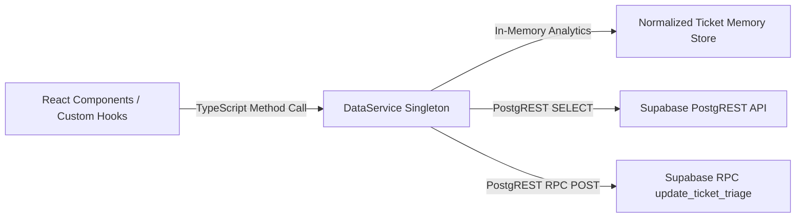

# Data Contracts & Service Interfaces (API.md)

**Document Version:** 1.0.0  
**Status:** Governed Service Contract Baseline  
**Service Implementation:** `src/services/dataService.ts`  
**Transport Protocol:** Direct Supabase PostgREST & Stored Procedures (RPC)  
**Client Interface:** TypeScript Singleton Service (`DataService`)

---

## 1. Architectural Model & Communication Pattern

The platform interacts with data sources through a governed **Service Layer Pattern**. UI components do not execute direct SQL or fetch raw mock JSON. All analytical computations, filter cascade logic, and triage operations flow through `DataService`:



---

## 2. Core Service Methods & Method Signatures

### 2.1 Analytics & Retrieval Contracts

#### `getSummaryMetrics(filter?: TicketFilter): SummaryMetrics`
- **Description**: Computes high-level executive KPIs across the active population.
- **Input**: Optional `TicketFilter` (department, priority, status, date range, search).
- **Output Interface**:
  ```typescript
  interface SummaryMetrics {
    totalTickets: number;         // Total matching records
    openTickets: number;          // Active backlog: Open + In Progress + Pending
    resolvedTickets: number;      // Resolved outcomes: Resolved + Closed
    avgResolutionHours: number;   // Mean turnaround across resolved records
    medianResolutionHours: number;// Median turnaround across resolved records
    slaCompliancePct: number;     // Compliant Resolved / Total Resolved * 100
    slaCompliantCount: number;    // Count of resolved tickets meeting target
    slaBreachedCount: number;     // Count of resolved tickets exceeding target
  }
  ```
- **Governance Rule**: When `resolvedTickets === 0`, `slaCompliancePct` returns `100.0` or `0.0` safely without `NaN` or division-by-zero errors.

#### `getMonthlyTrends(): MonthlyTrend[]`
- **Description**: Returns 12-month historical throughput curve across FY2024.
- **Output Interface**:
  ```typescript
  interface MonthlyTrend {
    month: string;           // E.g., 'Jan 2024'
    monthKey: string;        // E.g., '2024-01'
    created: number;         // Count of tickets created in month
    resolved: number;        // Count of tickets resolved in month
    slaCompliancePct: number;// Monthly retrospective SLA compliance %
  }
  ```

#### `getCategoryBreakdown(): CategoryBreakdown[]`
- **Description**: Aggregates ticket volume and SLA compliance grouped by the 6 technical categories.
- **Output**: Array of `{ categoryId, categoryName, ticketCount, percentage, slaCompliancePct }`.

#### `getPriorityBreakdown(): PriorityBreakdown[]`
- **Description**: Aggregates volume, target hours, and retrospective compliance across the 4 priority tiers (`Critical`, `High`, `Medium`, `Low`).

#### `getDepartmentBreakdown(): DepartmentBreakdown[]`
- **Description**: Returns volume, average turnaround, and CSAT rating across the 5 enterprise business units.

#### `getRecurringIssues(limit?: number): RecurringIssue[]`
- **Description**: Ranks issue types by ticket frequency with deterministic secondary sorting on issue title.
- **Output**: Array of `{ issueType, count, categoryName, slaBreachRate, avgResolutionHours }`.

#### `getResolutionDistribution(): ResolutionBucket[]`
- **Description**: Buckets resolved tickets into 5 turnaround intervals:
  1. `< 4 hours`
  2. `4 - 8 hours`
  3. `8 - 24 hours`
  4. `24 - 72 hours`
  5. `> 72 hours`
- **Governance Rule**: Excludes unresolved tickets (`resolution_time_hours === null`).

---

### 2.2 Operational Query & Triage Contracts

#### `getFilteredTickets(filter: TicketFilter, pagination?: PaginationParams): PaginatedResult<Ticket>`
- **Description**: Filters, sorts, and paginates tickets for data tables.
- **Supported Filter Attributes**:
  - `departmentId?: number`
  - `priority?: TicketPriority`
  - `status?: TicketStatus | 'Active Backlog'`
  - `searchQuery?: string` (Case-insensitive substring search across `ticket_id`, `issue_type`, `description`, `requester_name`)
  - `dateRange?: { start: string; end: string }`
- **Pagination**: Returns `{ items: Ticket[], total: number, page: number, pageSize: number, totalPages: number }`.

#### `getTicketById(ticketId: string): Ticket | undefined`
- **Description**: Fast $O(1)$ lookup returning a single ticket record with all resolved foreign key dimension titles.

---

### 2.3 Mutation & Triage Contracts

#### `createTicket(payload: CreateTicketPayload): Promise<Ticket>`
- **Validation**: Enforces non-empty subject, description, valid category ID, and priority.
- **Behavior**: Generates sequential `ticket_id` (e.g., `TCK-08001`), derives `sla_rule_id` based on priority, sets status to `'Open'`, and records `created_at` timestamp.
- **Persistence Mode**: Added immediately to in-memory store; triggers subscriber notifications.

#### `updateTicketTriage(ticketId: string, updates: TicketTriageUpdate): Promise<Ticket>`
- **Payload Interface**:
  ```typescript
  interface TicketTriageUpdate {
    status?: TicketStatus;
    priority?: TicketPriority;
    agentId?: number | null;
    teamId?: number | null;
    notes?: string;
  }
  ```
- **Validation & Business Constraints**:
  1. **Status Transition**: Verifies new status is one of `'Open'`, `'In Progress'`, `'Pending'`, `'Resolved'`, `'Closed'`.
  2. **Turnaround Recalculation**: If transitioned to `'Resolved'` or `'Closed'` and `resolved_at` is null, sets `resolved_at = now()`, calculates `resolution_time_hours`, and evaluates `sla_breached`. If transitioned from resolved back to open, clears `resolved_at` and `resolution_time_hours`.
  3. **Agent & Team Alignment**: Verifies that if `agentId` is assigned, the agent exists in canonical directory ($1\text{--}24$) and assigns their correct parent `teamId`.
  4. **Dimension Immutability**: Strips attempts to mutate historical dimensions (`created_at`, `department_id`, `issue_type`).
- **Rollback Behavior**: If remote Supabase write fails, the service catches the error, rolls back local state to the pre-mutation snapshot, and throws a typed `TriageError`.

---

## 3. Remote Supabase RPC Contract: `update_ticket_triage`

When operating against a live database with an authenticated user, mutations execute via the PostgreSQL function:

```sql
public.update_ticket_triage(
  p_ticket_id VARCHAR(20),
  p_status TEXT DEFAULT NULL,
  p_priority TEXT DEFAULT NULL,
  p_agent_id INTEGER DEFAULT NULL,
  p_team_id INTEGER DEFAULT NULL,
  p_unassign_agent BOOLEAN DEFAULT FALSE,
  p_resolution_notes TEXT DEFAULT NULL
) RETURNS JSONB
```

### 3.1 Input Parameters & Validation Matrix
| Parameter | PostgreSQL Type | Validation Rule | Error Thrown on Violation |
|:---|:---|:---|:---|
| `p_ticket_id` | `VARCHAR(20)` | Must be non-empty and exist in `public.tickets`. | `22023` (empty) / `P0002` (not found) |
| `p_status` | `TEXT` | Permitted values: `'Open'`, `'In Progress'`, `'Pending'`, `'Resolved'`, `'Closed'`. | `22023` Invalid status |
| `p_priority` | `TEXT` | Permitted values: `'Critical'`, `'High'`, `'Medium'`, `'Low'`. Must match SLA rule. | `22023` (invalid) / `23503` (missing SLA) |
| `p_agent_id` | `INTEGER` | Must exist in `public.agents` ($1\text{--}24$) or be `NULL`. Must be active (`is_active = TRUE`). | `23503` Agent not found / `23514` Inactive agent |
| `p_team_id` | `INTEGER` | If both agent and team are passed, agent must belong to team. Cross-team agent transfer rejected. | `23514` Inconsistent assignment |
| `p_unassign_agent` | `BOOLEAN` | If `TRUE`, unassigns ticket (`agent_id = NULL`). | - |
| `p_resolution_notes` | `TEXT` | Accepted for frontend contract compatibility; **not persisted** to `public.tickets` (no column in current schema). | - |
| *Role & Scope Rules* | `CONTEXT` | Caller must be verified staff; agent must act within assigned team queue and cannot mutate peer tickets; manager must manage team. | `42501` Unauthorized / Forbidden |

> [!NOTE]
> **Documented Parameter Reconciliation:** Earlier documentation referenced `p_sla_breached` and `p_notes`. In the active codebase, `dataService.ts` and `security_hardening_migration.sql` pass `p_unassign_agent` and `p_resolution_notes`. `sla_breached` is computed client-side and is not an RPC input.

### 3.2 Authorization Boundary & Model C Hybrid Enforcement
The function executes with `SECURITY DEFINER` (owned by `postgres`, `search_path = pg_catalog, pg_temp`) and enforces:

1. **Authentication & Role Gate**:
   - Caller must be authenticated (`auth.uid() IS NOT NULL`).
   - Role must be `'agent'`, `'manager'`, or `'admin'`. Ordinary employees and unmapped users receive `42501` (fail-closed).
2. **Support Agent Scope (`'agent'`)**:
   - Resolves caller identity via `public.current_agent_id()` and `public.current_agent_team_id()`. Unmapped or inactive agents receive `42501`.
   - **Team Isolation**: Ticket must belong to the agent's verified team (`ticket.team_id == caller_team_id`); otherwise raises `42501`.
   - **No Cross-Team Moves**: Agents cannot move tickets across teams (`p_team_id <> caller_team_id` raises `42501`).
   - **Peer Ticket Protection**: Tickets assigned to another agent cannot be modified, unassigned, or reassigned (`ticket.agent_id <> caller_agent_id` raises `42501`).
   - **Unassigned Ticket Claiming**: Unassigned tickets can only be triaged if the agent self-assigns (`p_agent_id = caller_agent_id`). Triaging unassigned tickets without claiming raises `42501`.
   - **Self-Unassignment**: An agent may unassign their own ticket (`p_unassign_agent = TRUE`), releasing it back to the team queue. Peer reassignment raises `42501` (requires manager).
3. **Operations Manager Scope (`'manager'`)**:
   - Scoped strictly via `public.is_team_manager(ticket.team_id)` backed by `public.team_managers`. Acting on an unauthorized team raises `42501`.
   - Inter-team transfers require managerial authority over both origin and destination teams (`public.is_team_manager(p_team_id)`).
   - Reassignment permitted between any active agents belonging to the destination team.
4. **Administrator Scope (`'admin'`)**:
   - Global authority across all teams and queues while enforcing relational agent-team consistency.

> [!IMPORTANT]
> **Staging Application Prerequisite:** Model C authorization logic is implemented locally in `it_support_analytics_dataset/sql/security_hardening_migration.sql`. It requires execution in a disposable staging environment with explicit administrative user-to-agent mappings in `public.agents.user_id` and `public.team_managers` before live testing.

---

## 4. CSV Export Specification

`DataService.exportTicketsToCsv(filter?: TicketFilter): string` exports the active population:

1. **RFC 4180 Escaping**:
   - Any value containing a comma (`,`), double quote (`"`), or newline (`\n`) is enclosed in double quotes.
   - Inner double quotes are escaped as two double quotes (`""`).
2. **Column Structure (13 Canonical Columns)**:
   ```csv
   ticket_id,created_at,resolved_at,status,priority,category,issue_type,department,team,agent,resolution_time_hours,sla_breached,satisfaction_rating
   ```
3. **Controlled Row Counts**:
   - Unfiltered live export: Exactly **8,001 lines** (1 header + 8,000 live ticket records).
   - If 1 session ticket was created in memory: Exactly **8,002 lines**.

---

## 5. Hydration & State Telemetry Contracts

#### `hydrateFromSupabase(): Promise<{ success: boolean; count: number; error?: string }>`
- Initiates asynchronous retrieval of `tickets`, `departments`, `teams`, `agents`, `categories`, and `sla_rules`.
- Passes raw rows through `DataNormalizer` to enforce types, range checks, and canonical mappings.
- Reconciles totals and broadcasts update event to subscribers.

#### `getProvenance(): DataProvenance`
```typescript
interface DataProvenance {
  dataSource: 'seeded' | 'live';
  hydrationStatus: 'idle' | 'hydrating' | 'hydrated' | 'error';
  totalTickets: number;
  hydratedAt: string | null;
  errorMessage?: string;
}
```

#### `getMutationCapability(): MutationCapability`
```typescript
interface MutationCapability {
  authMode: 'demo_session' | 'supabase_authenticated';
  canPersistRemotely: boolean;
  reason: string;
}
```
Informs UI components whether updates will persist to remote PostgreSQL or remain localized to the current demo browser session.
