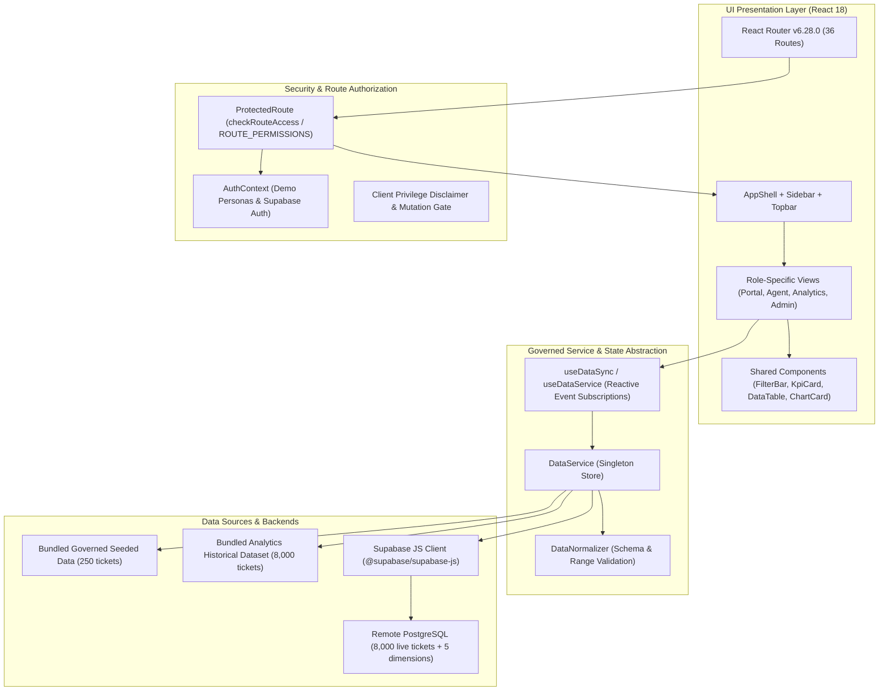
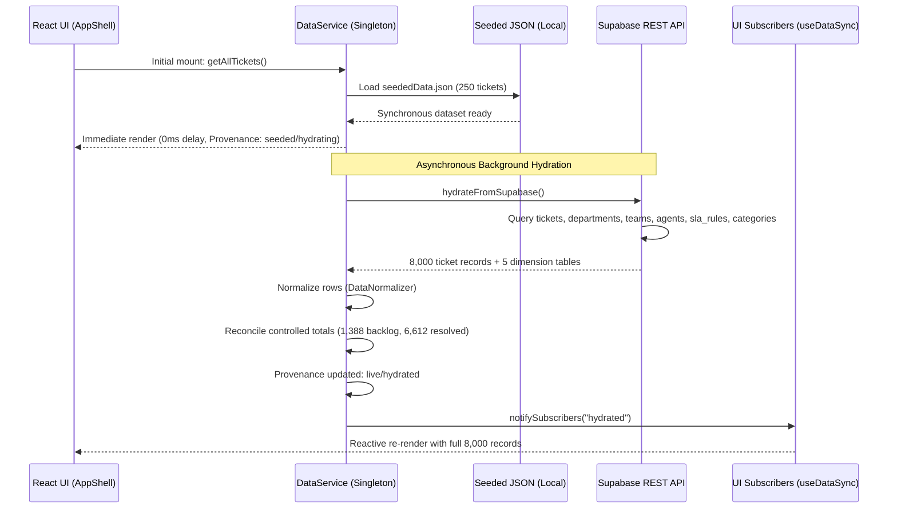

# Application Architecture — IT Support Ticket Analytics Platform

**Document Version:** 1.0.0  
**Status:** Governed Technical Architecture Baseline  
**Core Stack:** React 18.3.1 + TypeScript 5.6.3 + Vite 5.4.11 + Tailwind CSS 3.4.15 + Supabase JS Client  
**Hosting Model:** Single Page Application (SPA) deployed to Edge / Static CDN (Vercel)

---

## 1. Architectural Overview & Component Topology

The **IT Support Ticket Analytics Platform** is structured as a layered, service-oriented Single Page Application (SPA). It decouples user-interface rendering from underlying data sources via a dedicated service abstraction layer (`src/services/dataService.ts`).



---

## 2. Directory Structure & File Organization

```
it-support-analytics/
├── .env.example                 # Template for environment configuration
├── .env.local                   # Local credentials (VITE_SUPABASE_URL, VITE_SUPABASE_ANON_KEY)
├── docs/                        # Canonical Source of Truth Documentation
│   ├── PRD.md                   # Product Requirements Document
│   ├── DESIGN.md                # Design System & UX Standards
│   ├── ARCHITECTURE.md          # Application Architecture (This document)
│   ├── DATABASE.md              # Data Model, Relational Schema & Security
│   ├── API.md                   # Data Contracts & Service Interfaces
│   ├── AGENTS.md                # Permanent Coding Agent Rules
│   └── IMPLEMENTATION_PLAN.md   # Phased Engineering Roadmap
├── it_support_analytics_dataset/# Relational CSVs and SQL Assets
│   ├── data/                    # Clean & dirty CSV datasets
│   └── sql/                     # DDL, queries, and proposed security migrations
├── scripts/                     # Automated Verification & Test Harnesses
│   ├── check-security-migration.mjs
│   ├── import-dataset.mjs
│   ├── test-analytics-regression.mjs
│   ├── test-auth-routing.mjs
│   ├── test-hydration.mjs
│   ├── test-normalization.mjs
│   ├── test-ticket-persistence.mjs
│   └── verify-evidence.mjs
├── src/
│   ├── App.tsx                  # Root router, code-split lazy routes, providers
│   ├── main.tsx                 # Application bootstrap entry point
│   ├── index.css                # Global Tailwind directives & token utilities
│   ├── components/
│   │   ├── auth/                # Sign-in and OTP verification components
│   │   ├── common/              # FilterBar, KpiCard, DataTable, ChartCard, Skeleton
│   │   └── layout/              # AppShell, Sidebar, Topbar, RoleSwitcher
│   ├── config/
│   │   └── permissions.ts       # Role definitions, ROUTE_PERMISSIONS matrix, action rules
│   ├── context/
│   │   └── AuthContext.tsx      # User session state, demo switching, OTP validation
│   ├── data/
│   │   ├── seededData.json      # Synchronous initial fallback dataset (250 tickets)
│   │   └── analyticsTickets.json# Clean 8,000 reference baseline
│   ├── lib/
│   │   └── supabase.ts          # Supabase client instantiation & connection helpers
│   ├── pages/
│   │   ├── admin/               # Admin overview, SLA config, data workbench
│   │   ├── agent/               # Agent dashboard, queue, ticket detail, workload
│   │   ├── analytics/           # Executive overview, trends, resolution, SLA deep-dives
│   │   ├── auth/                # Login, 2FA OTP, password recovery
│   │   ├── portal/              # Employee self-service home, wizard, my tickets
│   │   ├── public/              # Landing page, error pages (403, 404)
│   │   └── shared/              # Profile, notifications
│   ├── services/
│   │   ├── dataNormalizer.ts    # Schema validation, canonical agent resolution, bounds
│   │   └── dataService.ts       # Central data store, caching, hydration, mutations
│   └── types/
│       └── ticket.ts            # TypeScript interfaces for tickets, metrics, dimensions
├── tailwind.config.js           # Tailwind token configuration
├── tsconfig.json                # TypeScript compiler configuration (strict mode)
└── vite.config.ts               # Vite build configuration, chunk splitting
```

---

## 3. Data Flow & Dual-Mode Hydration Strategy

To resolve the tension between immediate UI rendering and full 8,000-record analytics, the application implements a **Dual-Mode Hydration Protocol**:



### 3.1 Provenance Tracking
`DataService.getProvenance()` exposes real-time telemetry consumed by UI headers:
- `dataSource`: `'seeded'` (bundled fallback) | `'live'` (remote Supabase).
- `hydrationStatus`: `'idle'` | `'hydrating'` | `'hydrated'` | `'error'`.
- `totalTickets`: Dynamic count (250 initial -> 8,000 live).
- `hydratedAt`: ISO timestamp of the latest successful synchronization.

---

## 4. State Management & Reactive Subscriptions

Rather than introducing heavy external state management libraries (such as Redux or MobX), the platform uses a lightweight, type-safe **Observer Subscription Pattern**:

```typescript
// Core subscription contract inside dataService.ts
type Listener = () => void;
private listeners: Set<Listener> = new Set();

public subscribe(listener: Listener): () => void {
  this.listeners.add(listener);
  return () => { this.listeners.delete(listener); };
}

private notifySubscribers(): void {
  for (const listener of this.listeners) {
    listener();
  }
}
```

The custom hook `useDataSync()` binds React component lifecycles directly to this singleton store:
```typescript
export function useDataSync() {
  const [, setTick] = useState(0);
  useEffect(() => {
    return dataService.subscribe(() => setTick(t => t + 1));
  }, []);
}
```
Whenever ticket triage occurs or background hydration completes, every subscribing view updates synchronously without requiring full page reloads.

---

## 5. Security Architecture & Privilege Boundaries

### 5.1 Presentation vs. Remote Capability Gate
The application clearly distinguishes client presentation from server-enforced authorization:

```typescript
// Evaluates exact capability of active session
export function getMutationCapability(): {
  authMode: 'demo_session' | 'supabase_authenticated';
  canPersistRemotely: boolean;
  reason: string;
}
```
- **Demo Mode**: When using simulated demo logins (`employee`, `agent`, `manager`, `admin`), mutations operate exclusively within **in-memory client state**. The application disallows direct remote database mutations and logs an explicit governance notice.
- **Supabase Authenticated Mode**: Enabled only when a cryptographically verified Supabase JWT session exists. Mutations route through stored procedures (`public.update_ticket_triage`).

### 5.2 Environment Variables & Secrets Separation
- **`VITE_SUPABASE_URL`**: Public API endpoint.
- **`VITE_SUPABASE_ANON_KEY`**: Public anonymous role key (strictly limited by Row Level Security).
- **`SUPABASE_SERVICE_ROLE_KEY`**: Strictly forbidden in frontend code and `.env.local`. Handled exclusively in offline administrative scripts (`import-dataset.mjs`).

---

## 6. Code Splitting & Performance Strategy

To maintain an initial JavaScript bundle under 150 kB (gzipped), `src/App.tsx` configures granular code-splitting via `React.lazy` and `Suspense`:

```typescript
// Granular Lazy Loading in src/App.tsx
const EmployeeHome = React.lazy(() => import('./pages/portal/EmployeeHome'));
const AgentHome = React.lazy(() => import('./pages/agent/AgentHome'));
const AnalyticsOverview = React.lazy(() => import('./pages/analytics/AnalyticsOverview'));
const AdminPages = React.lazy(() => import('./pages/admin/AdminPages'));
```

### Vite Chunking Strategy (`vite.config.ts`)
```typescript
build: {
  rollupOptions: {
    output: {
      manualChunks: {
        'vendor-react': ['react', 'react-dom', 'react-router-dom'],
        'vendor-charts': ['recharts'],
        'vendor-icons': ['lucide-react'],
      }
    }
  }
}
```
This isolates heavy chart-rendering dependencies (`recharts`) and icon packages (`lucide-react`), ensuring rapid first-contentful-paint (FCP) on authentication and portal routes.

---

## 7. Testing & Quality Assurance Strategy

Automated test harnesses run in Node.js ESM environments using standalone regression runners:
- **`test-analytics-regression.mjs`**: Validates monthly trends, resolution distribution boundaries, recurring issues ranking, and metric reconciliation rules.
- **`test-normalization.mjs`**: Enforces strict typing, range limits ($CSAT \in [1,5]$, $turnaround \in [0, 8760]$), and canonical agent name mapping.
- **`test-hydration.mjs`**: Verifies dynamic live Supabase hydration of 8,000 tickets, type preservation, and filter isolation.
- **`test-ticket-persistence.mjs`**: Tests triage status transitions, agent assignment, team validation, and rollback on permission rejection.
- **`test-auth-routing.mjs`**: Tests 36 application paths against the `ROUTE_PERMISSIONS` matrix for all 4 user roles.
- **`verify-evidence.mjs`**: Audits open ticket counts, RFC 4180 CSV escaping, baseline labels, and subscription reactivity.
- **`npm run build` (`tsc && vite build`)**: Enforces zero TypeScript compile errors and valid production asset creation.
