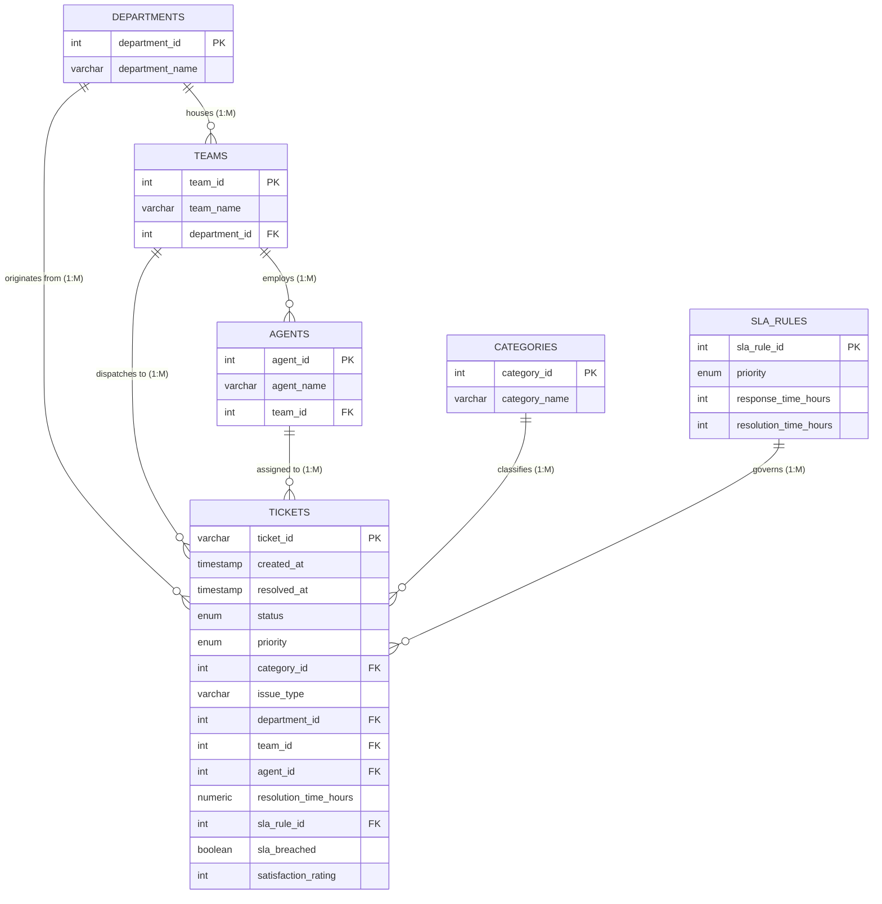

# Database Architecture, Data Model & Security Specification

**Document Version:** 1.0.0  
**Status:** Governed Data Source of Truth  
**Target Database Engine:** PostgreSQL 15+ (Supabase Managed Engine)  
**Schema Pattern:** Analytical Snowflake / Star Schema (1 Fact Table, 5 Dimension Tables)

---

## 1. Schema Topology & Entity-Relationship Model

The platform structures support ticket operations using a star/snowflake schema optimized for both transactional triage lookups and multi-dimensional analytical aggregation.



---

## 2. Table Specifications & Column Dictionary

### 2.1 Fact Table: `public.tickets`
Contains transactional ticket records across calendar year 2024. Total clean row count: **8,000**.

| Column Name | Data Type | Nullable | Primary / Foreign Key | Description & Governed Business Constraints |
|:---|:---|:---|:---|:---|
| `ticket_id` | `VARCHAR(20)` | No | **PK** | Unique ticket identifier (e.g., `TCK-00001` to `TCK-08000`). |
| `created_at` | `TIMESTAMPTZ` | No | - | Timestamp when ticket was submitted. Historical dimension (immutable). |
| `resolved_at` | `TIMESTAMPTZ` | Yes | - | Timestamp when ticket was marked Resolved or Closed. Null for active backlog. |
| `status` | `ticket_status` | No | - | ENUM: `'Open'`, `'In Progress'`, `'Pending'`, `'Resolved'`, `'Closed'`. |
| `priority` | `ticket_priority`| No | - | ENUM: `'Critical'`, `'High'`, `'Medium'`, `'Low'`. Must match `sla_rule_id`. |
| `category_id` | `INTEGER` | No | **FK** -> `categories.category_id` | Foreign key referencing technical category ($1\text{--}6$). |
| `issue_type` | `VARCHAR(100)`| No | - | Canonical description of technical symptom (e.g., *"VPN connection failure"*). |
| `department_id`| `INTEGER` | No | **FK** -> `departments.department_id`| Business unit generating the ticket ($1\text{--}5$). |
| `team_id` | `INTEGER` | Yes | **FK** -> `teams.team_id` | Assigned support team ($1\text{--}8$). Derived automatically from agent. |
| `agent_id` | `INTEGER` | Yes | **FK** -> `agents.agent_id` | Assigned support specialist ($1\text{--}24$). Null for unassigned queue. |
| `resolution_time_hours`| `NUMERIC(8,2)`| Yes | - | Total turnaround hours. Null for open tickets; matches $\frac{\text{resolved\_at}-\text{created\_at}}{3600}$. |
| `sla_rule_id` | `INTEGER` | No | **FK** -> `sla_rules.sla_rule_id` | Target SLA tier ($1\text{--}4$). |
| `sla_breached`| `BOOLEAN` | - | - | **Client-derived metric** (computed dynamically in memory / service layer via $\text{resolution\_time\_hours} > \text{target\_resolution\_hours}$). Not a physical table column in `supabase_schema.sql`. |
| `satisfaction_rating` | `INTEGER` | Yes | - | CSAT survey score: Integer $1\text{--}5$. Null where user submitted no rating. |

### 2.2 Dimension Tables

#### A. `public.departments` (5 Records)
- `department_id` (PK, Integer $1\text{--}5$)
- `department_name` (`VARCHAR(100)`): `Corporate IT` (1), `Customer Support` (2), `Engineering` (3), `Human Resources` (4), `Sales & Marketing` (5).
- `created_at` (`TIMESTAMPTZ`)

#### B. `public.categories` (6 Records)
- `category_id` (PK, Integer $1\text{--}6$)
- `category_name` (`VARCHAR(100)`): `Hardware` (1), `Software` (2), `Network` (3), `Access & Identity` (4), `Security` (5), `Other` (6).
- `subcategory_name` (`VARCHAR(150)`): Standardized ITIL subcategories.

#### C. `public.teams` (8 Records)
- `team_id` (PK, Integer $1\text{--}8$)
- `team_name` (`VARCHAR(100)`): `Service Desk Tier 1` (1), `Network Operations` (2), `Identity Management` (3), `Workplace Tech` (4), `Security Operations` (5), `Enterprise Apps` (6), `Cloud Infrastructure` (7), `VIP Support` (8).
- `department_id` (FK -> `departments.department_id`).
- `created_at` (`TIMESTAMPTZ`)

#### D. `public.agents` (24 Records)
- `agent_id` (PK, Integer $1\text{--}24$)
- `agent_code` (`VARCHAR(20)` UNIQUE NOT NULL): `AGT-001` through `AGT-024`.
- `agent_name` (`VARCHAR(100)` NOT NULL in canonical DDL; **known remote drift: omitted in live remote Supabase import**, resolved client-side via `CANONICAL_AGENT_NAMES`).
- `team_id` (FK -> `teams.team_id`).
- `experience_band` (`agent_experience_band` ENUM): `'Junior'`, `'Mid-level'`, `'Senior'`.
- `is_active` (`BOOLEAN` NOT NULL DEFAULT TRUE).
- `user_id` (`UUID UNIQUE NULL REFERENCES auth.users(id) ON DELETE SET NULL`): Cryptographic identity link connecting Supabase Auth accounts to canonical support agents (defined in local canonical DDL and security migration).
- `created_at` (`TIMESTAMPTZ`)

#### E. `public.sla_rules` (4 Records)
- `sla_rule_id` (PK, Integer $1\text{--}4$)
- `priority` (`ticket_priority` ENUM UNIQUE): `Critical` (1), `High` (2), `Medium` (3), `Low` (4).
- `target_resolution_hours` (`DECIMAL(6,2)` NOT NULL): `4.00`, `8.00`, `24.00`, `72.00` calendar hours.
- `description` (`VARCHAR(255)` NULL).
- *(Note: `response_time_hours` was documented in early drafts but is not a physical column in `supabase_schema.sql`)*.

#### F. `public.team_managers` (Mapping Table — Security Migration Extension)
- `user_id` (`UUID NOT NULL REFERENCES auth.users(id) ON DELETE CASCADE`): Manager user identity.
- `team_id` (`INTEGER NOT NULL REFERENCES public.teams(team_id) ON DELETE CASCADE`): Authorized support team.
- `assigned_at` (`TIMESTAMPTZ NOT NULL DEFAULT CURRENT_TIMESTAMP`): Timestamp of team managerial delegation.
- `assigned_by` (`UUID REFERENCES auth.users(id)`): Administrator who delegated managerial authority.
- **Primary Key**: `(user_id, team_id)`.
- RLS enabled; managed strictly by administrators via `sec_admin_manage_team_managers`.

---

## 3. Governed Controlled Totals & Benchmark Verification

Direct validation against the reference dataset (`it_support_analytics_dataset/data/tickets.csv`):

| Metric Classification | Governed Controlled Total | Derivation Rule & Sub-Group Breakdown |
|:---|:---|:---|
| **Total Ticket Universe** | **8,000** | Total distinct clean transaction records in FY2024. |
| **Active Open Backlog** | **1,388** | Sum of non-resolved tickets: `Open` (552) + `In Progress` (523) + `Pending` (313). |
| **Resolved Outcomes** | **6,612** | Sum of resolved states: `Resolved` (4,882) + `Closed` (1,730). |
| **SLA Compliant Outcomes** | **5,814** | Resolved tickets completed within priority SLA limits. |
| **SLA Breaches** | **798** | Resolved tickets exceeding priority SLA limits. |
| **Retrospective SLA Compliance** | **87.9%** | $\frac{5,814}{6,612} = 87.93\%$. Unresolved tickets are strictly excluded. |
| **Mean Resolution Turnaround**| **14.9 hrs** | Average calendar hours across 6,612 resolved records. |
| **Median Resolution Turnaround**| **7.32 hrs** | 50th percentile turnaround across 6,612 resolved records. |

### 3.1 Dirty Dataset QA Benchmarking (`tickets_raw_dirty.csv`)
The repository includes a controlled 8,040-row dataset containing 120 synthetic defects used for automated data-quality audits:
- **Duplicate Rows**: 40 duplicate records (8,040 rows for 8,000 unique `ticket_id`s).
- **Inverted Timestamps**: 22 records where `resolved_at < created_at`.
- **Corrupted Turnaround Durations**: 17 records with `resolution_time_hours = 9999`.
- **Orphan Department IDs**: 30 records referencing non-existent `department_id = 888`.
- **Orphan Category IDs**: 30 records referencing non-existent `category_id = 999`.
- **Missing Required Attributes**: 84 blank cells across required columns.

---

## 4. Query Patterns & Recommended Indexes

Production performance queries rely on specific composite indexing structures defined in `it_support_analytics_dataset/sql/create_schema.sql`:

```sql
-- 1. Status & Active Backlog Filtering
CREATE INDEX idx_tickets_status ON public.tickets (status);

-- 2. Priority & SLA Compliance Filtering
CREATE INDEX idx_tickets_priority ON public.tickets (priority);
CREATE INDEX idx_tickets_sla_breached ON public.tickets (sla_breached);

-- 3. Temporal Analytics & Date Range Filtering
CREATE INDEX idx_tickets_created_at ON public.tickets (created_at);
CREATE INDEX idx_tickets_resolved_at ON public.tickets (resolved_at);

-- 4. Foreign Key Lookup Performance
CREATE INDEX idx_tickets_dept ON public.tickets (department_id);
CREATE INDEX idx_tickets_team ON public.tickets (team_id);
CREATE INDEX idx_tickets_agent ON public.tickets (agent_id);
CREATE INDEX idx_tickets_cat ON public.tickets (category_id);

-- 5. Operational Composite Index for Triage Dispatch
CREATE INDEX idx_tickets_triage_queue ON public.tickets (status, priority, created_at)
WHERE status IN ('Open', 'In Progress', 'Pending');
```

---

## 5. Security Architecture, RLS Policies & Hardening Migration

### 5.1 Remote Database vs. Local Artifact Status
> [!IMPORTANT]
> **VERIFIED VS. UNVERIFIED BOUNDARY**:
> - **Current Live Supabase Database**: Configured with baseline permissive read-only access (`CREATE POLICY "Allow public read-only access" ON public.tickets FOR SELECT USING (true)`).
> - **Security Hardening Migration (`security_hardening_migration.sql`)**: **NOT YET EXECUTED** on the remote database. It has been validated through static regex/AST testing and the disposable staging protocol (`docs/staging-security-verification.md`), but live remote execution requires explicit user authorization.

### 5.2 Implemented Local Security Architecture (`security_hardening_migration.sql`)
1. **Administrative Role Mapping Table**:
   ```sql
   CREATE TABLE IF NOT EXISTS public.user_roles (
     user_id UUID PRIMARY KEY REFERENCES auth.users(id) ON DELETE CASCADE,
     role VARCHAR(20) NOT NULL CHECK (role IN ('agent', 'manager', 'admin')),
     created_at TIMESTAMPTZ NOT NULL DEFAULT CURRENT_TIMESTAMP,
     updated_at TIMESTAMPTZ NOT NULL DEFAULT CURRENT_TIMESTAMP
   );
   ```
2. **Agent Identity & Multi-Team Manager Mapping Tables (Model C Hybrid)**:
   - `ALTER TABLE public.agents ADD COLUMN IF NOT EXISTS user_id UUID UNIQUE REFERENCES auth.users(id) ON DELETE SET NULL;`
   - `CREATE TABLE IF NOT EXISTS public.team_managers (user_id UUID, team_id INTEGER, PRIMARY KEY (user_id, team_id));`
3. **Helper Functions (Recursion-Free & Strict Search Path Lockdown)**:
   - `public.is_admin()`: Resolves whether `auth.uid()` has `admin` role in `public.user_roles`. Declared with `SECURITY DEFINER` and `SET search_path = pg_catalog, pg_temp`.
   - `public.current_user_role()`: Returns `'admin'`, `'manager'`, `'agent'`, or `'authenticated'`.
   - `public.current_agent_id()`: Resolves verified agent ID for caller `auth.uid()`. Returns `NULL` if caller is not mapped or inactive.
   - `public.current_agent_team_id()`: Resolves verified support team ID for caller `auth.uid()`.
   - `public.is_team_manager(p_team_id INTEGER)`: Verifies caller holds `'manager'` or `'admin'` role and is explicitly mapped to `p_team_id` in `public.team_managers` (admins evaluate to `TRUE` globally).
4. **Queue-Level Row Level Security (`sec_staff_select_tickets`)**:
   - Fact table reads restricted to verified staff roles (`agent`, `manager`, `admin`).
   - Admins: read all tickets across all teams.
   - Managers: read tickets only in explicitly assigned teams (`public.is_team_manager(team_id)`).
   - Agents: read tickets only in verified active team queue (`team_id = public.current_agent_team_id()`).
   - Ordinary employees and unmapped callers: receive 0 rows (enterprise operational queue shielded).
5. **Operational Triage Stored Procedure (`update_ticket_triage`)**:
   - Direct `UPDATE` grants on `public.tickets` are **REVOKED** from client roles (`authenticated`, `anon`, `PUBLIC`).
   - All status, priority, and assignment updates must route through `public.update_ticket_triage()`.
   - Enforces row locking (`FOR UPDATE`), status validation, agent-team matching, and immutability of historical dimensions (`created_at`, `department_id`, `issue_type`).
   - Enforces Model C Agent Guardrails: rejects peer-assigned ticket modification (`42501`), rejects cross-team transfers (`42501`), enforces self-assignment on unassigned tickets, allows self-unassignment back to team queue, rejects peer reassignment (`42501`).
   - Enforces Manager Scope: permits triage and transfers only across teams explicitly mapped in `public.team_managers`.

### 5.3 Known Schema Identity & Column Limitations
- **Lack of User ID Foreign Key on Tickets**: The current `public.tickets` table does not contain a `created_by_user_id UUID REFERENCES auth.users(id)` column.
  - *Current Security Stance*: Ordinary authenticated employees receive zero operational fact-table read access under least privilege (`sec_staff_select_tickets`). Employee ticket filtering is performed in client memory by matching `requester_email` against local session demo records. Row-level employee ticket ownership in production will require an approved schema addition (`ALTER TABLE public.tickets ADD COLUMN created_by_user_id UUID`).
- **Agent Identity Mapping Local vs. Remote State**:
  - `user_id UUID UNIQUE` on `public.agents` is defined in canonical local DDL (`it_support_analytics_dataset/sql/supabase_schema.sql`) and `it_support_analytics_dataset/sql/security_hardening_migration.sql`.
  - **Local-Only Status**: This column is unapplied on remote Supabase databases until executed in a provisioned disposable staging environment.
  - **Administrative Mapping Rule**: In staging/production, existing agents remain unmapped (`user_id = NULL`) until explicitly associated by an administrator. Auto-mapping by email or ID is prohibited.
- **Absence of `resolution_notes` Column on Tickets**: `public.tickets` does not contain a `resolution_notes TEXT` column.
  - *Current Behavior*: The `update_ticket_triage` RPC accepts `p_resolution_notes` to preserve frontend TypeScript interface compatibility, but does not persist notes to the database table. Storing resolution notes remotely requires an approved schema addition (`ALTER TABLE public.tickets ADD COLUMN resolution_notes TEXT`).
