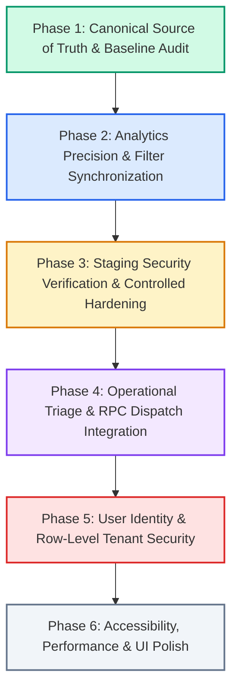

# Governed Implementation Plan & Engineering Roadmap

**Document Version:** 1.0.0  
**Status:** Governed Engineering Roadmap  
**Product Identity:** IT Support Ticket Analytics Platform (`it-support-analytics`)  
**Core Principle:** Prioritize analytical correctness, data integrity, usability, security, and reliability over cosmetic changes.

---

## 1. Roadmap Overview & Execution Phases

| Phase | Title | Focus Area | Status | Gate Requirement |
|:---|:---|:---|:---|:---|
| **Phase 1** | Canonical Source of Truth & Baseline Audit | Documentation, baseline tests, code audit | **COMPLETED** | Zero code changes outside docs |
| **Phase 2** | Analytics Precision & Drill-Down Synchronization | Filter reconciliation, exception tables, CSV parity | **READY FOR IMPLEMENTATION** | Pass regression tests |
| **Phase 3** | Staging Security Verification & Hardening | Disposable staging validation of SQL migration | **BLOCKED ON STAGING ENV** | User approval + disposable staging |
| **Phase 4** | Operational Triage & RPC Dispatch Integration | Optimistic updates, RPC error rollback, team validation | **DEPENDS ON PHASE 3** | Test suite + user approval |
| **Phase 5** | Production User Identity & Row-Level Security | Schema evolution: add `created_by_user_id` | **REQUIRES MIGRATION APPROVAL** | User approval for DDL |
| **Phase 6** | Accessibility, Performance & Final Polish | WCAG 2.1 AA audit, bundle optimization, mobile UX | **FINAL STAGE** | Lighthouse & accessibility audit |

---

## 2. Phase-by-Phase Detailed Specifications

### Phase 1: Canonical Source of Truth & Baseline System Audit
- **Goal**: Establish the authoritative documentation set (`PRD.md`, `DESIGN.md`, `ARCHITECTURE.md`, `DATABASE.md`, `API.md`, `AGENTS.md`, `IMPLEMENTATION_PLAN.md`), verify baseline builds, and record initial test metrics without modifying existing application logic.
- **Current Problem & Evidence**: Codebase had multiple historical audit reports and scattered documentation; needed a unified, governed source of truth reflecting current architecture and exact controlled totals.
- **Tasks & Files Affected**:
  - Author `docs/PRD.md`, `docs/DESIGN.md`, `docs/ARCHITECTURE.md`, `docs/DATABASE.md`, `docs/API.md`, `docs/AGENTS.md`, `docs/IMPLEMENTATION_PLAN.md`.
  - Author root `AGENTS.md` for tool discovery.
- **Dependencies**: None.
- **Risks**: None (documentation only).
- **Required Tests**: `npm run build`, all 6 regression scripts.
- **Acceptance Criteria**: Zero TypeScript errors; 100% test pass rate across all suites; comprehensive docs created.
- **Status**: **COMPLETED**.

---

### Phase 2: Analytics Precision, Filter Reconciliation & Drill-Down Synchronization
- **Goal**: Guarantee that every KPI card, chart series, table breakdown, and drill-down link reconciles to the exact filtered population across all analytics routes.
- **Current Problem & Evidence**:
  - Filter state in `FilterBar.tsx` occasionally drops when navigating between `/analytics/overview` and deep-dive routes (`/analytics/sla`, `/analytics/resolution`).
  - Active Backlog terminology (1,388 tickets = Open 552 + In Progress 523 + Pending 313) must remain crystal clear when clicking KPI cards to drill into queue tables.
- **Tasks & Likely Files Affected**:
  - `src/components/common/FilterBar.tsx`: Persist active filter state to URL query parameters (`useSearchParams`).
  - `src/pages/analytics/AnalyticsOverview.tsx`: Ensure KPI card click handlers pass active filters when routing to `/analytics/sla` or `/agent/tickets`.
  - `src/pages/analytics/DeepDivePages.tsx`: Synchronize drill-down table filters with global state.
  - `src/services/dataService.ts`: Ensure tie-breaking logic in recurring issues and team scorecards is 100% deterministic.
- **Dependencies**: Phase 1 baseline.
- **Risks**: Potential regression in URL parsing if invalid query parameters are supplied.
- **Required Tests**:
  - `scripts/test-analytics-regression.mjs`
  - `scripts/verify-evidence.mjs`
- **Acceptance Criteria**:
  - Clicking "Active Backlog (1,388)" navigates to `/agent/tickets?status=Active+Backlog` showing exactly 1,388 records.
  - Clicking "SLA Breaches (798)" filters the list to exactly 798 breached resolved tickets.
  - Active filters persist across route transitions via URL parameters.
- **Manual Verification Requirements**: Inspect browser URL state during filter changes; verify table record counts match KPI card figures.

---

### Phase 3: Staging Security Verification & Controlled Database Hardening
- **Goal**: Execute runtime verification of `security_hardening_migration.sql` against an isolated, disposable Supabase staging instance, followed by controlled live application upon explicit user approval.
- **Current Problem & Evidence**:
  - Live Supabase instance currently operates with permissive read-only RLS (`Allow public read-only access` with `USING (true)`).
  - Proposed SQL hardening migration revokes direct updates and routes triage through `public.update_ticket_triage()`, but has only been checked via static heuristics (`check-security-migration.mjs`).
- **Tasks & Likely Files Affected**:
  - Configure disposable staging credentials (`SUPABASE_STAGING_URL`, `SUPABASE_STAGING_KEY`).
  - Execute `scripts/check-security-migration.mjs --staging` against disposable staging.
  - Validate all 15 staging test matrix checks (deny anonymous facts, reject direct updates, test agent RPC).
  - Upon user approval, apply migration to remote environment.
- **Dependencies**: User provisioning of disposable staging Supabase project and explicit approval.
- **Risks**:
  - If applied to live production prematurely, client roles without mapped `user_roles` will lose operational access.
- **Required Tests**:
  - `scripts/check-security-migration.mjs` (All 15 live staging tests must pass).
  - `scripts/test-ticket-persistence.mjs`
- **Acceptance Criteria**:
  - Anonymous callers receive HTTP 401/403 or error 42501 when selecting `public.tickets`.
  - Authorized agents successfully triage tickets via RPC.
  - Direct SQL `UPDATE` on `public.tickets` is blocked by PostgreSQL.
- **Manual Verification Requirements**: Attempt unauthenticated PostgREST request in staging; verify permission denied.

---

### Phase 4: Operational Triage & Real RPC Integration
- **Goal**: Connect agent workspace UI actions (`/agent/tickets/:id`) directly to Supabase RPC `public.update_ticket_triage()` when live authentication is active, maintaining graceful client-session fallback in demo mode.
- **Current Problem & Evidence**:
  - `DataService.updateTicketTriage()` currently performs in-memory updates in demo mode. When an authenticated user is present, it must cleanly invoke `supabase.rpc('update_ticket_triage', {...})` with full optimistic UI updates and instant rollback on failure.
- **Tasks & Likely Files Affected**:
  - `src/services/dataService.ts`: Wire `supabase.rpc('update_ticket_triage')` into `updateTicketTriage()`.
  - `src/pages/agent/AgentTicketDetail.tsx`: Add conflict detection (handling concurrent updates) and visual feedback banner.
  - `src/components/layout/RoleSwitcher.tsx`: Provide explicit indicator when mutations are in demo mode vs. live database persistence.
- **Dependencies**: Phase 3 database hardening in place.
- **Risks**: Network latency during triage updates; state divergence if optimistic update is not rolled back cleanly on network timeout.
- **Required Tests**:
  - `scripts/test-ticket-persistence.mjs`
  - Unit tests for optimistic rollback on 500/403 errors.
- **Acceptance Criteria**:
  - Triage actions update UI within 50ms (optimistic).
  - Failed network calls roll back UI state with a clear error toast.
  - Demo mode continues to work safely without network errors.
- **Manual Verification Requirements**: Test status update in browser with simulated offline mode; verify clean rollback.

---

### Phase 5: Production User Identity & Row-Level Authorization
- **Goal**: Evolve the database schema to associate tickets with authentic user identities (`created_by_user_id`), enabling true server-enforced Row Level Security for employee personal tickets.
- **Current Problem & Evidence**:
  - `public.tickets` lacks a `created_by_user_id` column; employee ticket isolation currently relies on client-side filtering on `requester_email`.
- **Tasks & Likely Files Affected**:
  - Draft proposed schema migration: `ALTER TABLE public.tickets ADD COLUMN created_by_user_id UUID REFERENCES auth.users(id)`.
  - Add RLS policy: `CREATE POLICY "sec_employee_select_own_tickets" ON public.tickets FOR SELECT TO authenticated USING (created_by_user_id = auth.uid() OR public.is_admin() OR public.current_user_role() IN ('agent', 'manager'))`.
  - Update `src/pages/portal/CreateTicketPage.tsx` and `dataService.ts` to attach `auth.uid()`.
- **Dependencies**: Explicit user approval for schema DDL change.
- **Risks**: Schema migration on live table with 8,000 existing rows; existing rows will have `NULL` `created_by_user_id`.
- **Required Tests**:
  - Migration script test in staging environment.
  - `scripts/test-auth-routing.mjs`
- **Acceptance Criteria**:
  - Authenticated employees can only query their own submitted tickets via PostgREST.
  - Staff (agents, managers, admins) retain company-wide queue access.
- **Manual Verification Requirements**: Log in as test employee; verify direct Supabase API call returns only personal records.

---

### Phase 6: Accessibility, Performance Optimization & UI Polish
- **Goal**: Ensure the application achieves enterprise-grade accessibility (WCAG 2.1 AA compliance), responsive elegance, and sub-second navigation performance.
- **Current Problem & Evidence**:
  - Several custom interactive controls (e.g. custom dropdowns in `FilterBar`) require full keyboard `aria-*` attributes.
  - Mobile layout on small screens (<375px) requires verification of touch targets and table horizontal scrolling.
- **Tasks & Likely Files Affected**:
  - `src/components/common/FilterBar.tsx`: Add keyboard arrow navigation and `aria-expanded` attributes.
  - `src/components/common/DataTable.tsx`: Enhance mobile card view fallback for responsive displays.
  - `src/components/layout/Sidebar.tsx`: Ensure mobile drawer trap-focus works properly.
- **Dependencies**: Phases 1–4.
- **Risks**: Low risk (UI presentation enhancements).
- **Required Tests**:
  - Automated accessibility audit (axe-core / Lighthouse).
  - Production build bundle size audit.
- **Acceptance Criteria**:
  - Zero critical WCAG 2.1 AA violations.
  - Keyboard navigation allows full ticket creation, triage, and filtering without mouse input.
  - Mobile viewport (320px) renders without horizontal canvas overflow.
- **Manual Verification Requirements**: Screen reader and keyboard-only walkthrough.
