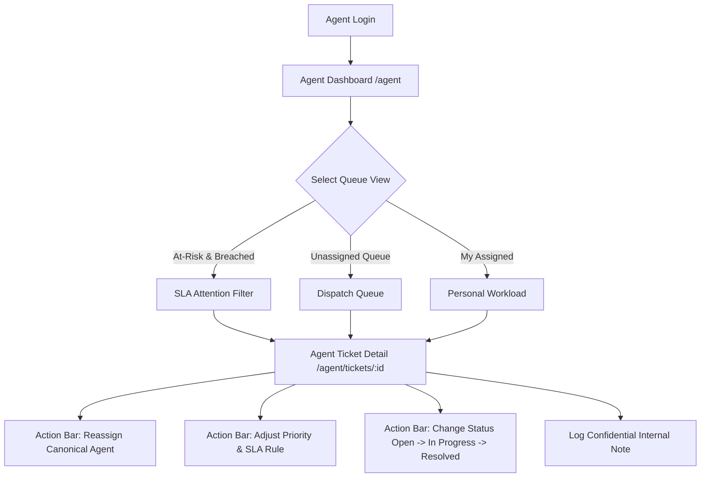
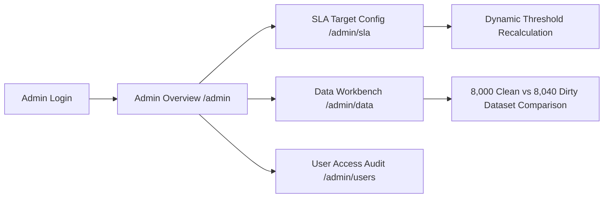

# Product Requirements Document (PRD) — IT Support Ticket Analytics Platform

**Document Version:** 1.0.0  
**Status:** Governed Operational Baseline  
**Product Identity:** IT Support Ticket Analysis & Service Management Analytics  
**Architecture Classification:** Enterprise Web Application (React 18 + TypeScript + Vite + Supabase)

---

## 1. Executive Summary & Value Proposition

The **IT Support Ticket Analytics Platform** is a multi-persona operational and strategic service-intelligence web application. It bridges day-to-day IT service desk management (ITSM) with executive analytics, SLA compliance governance, and workload distribution.

### 1.1 Problem Statement
In enterprise IT organizations, operational ticketing data is frequently siloed inside transactional ticketing systems (e.g., ServiceNow, Jira Service Management) without intuitive executive visibility, resulting in:
- Unclear operational visibility into active backlog accumulation versus intake throughput.
- Misunderstood SLA performance caused by mixing open and resolved tickets in compliance denominators.
- Reactive triage with insufficient prioritization for at-risk and breached tickets.
- Disconnected team capacity management where workload imbalances between senior and junior tiers go unnoticed.
- Lack of self-service transparency for employees tracking ongoing incidents and requests.

### 1.2 Core Value Proposition
> *"Transform raw support ticket transactions into actionable operational visibility, SLA accountability, and informed managerial decision-making across the entire service lifecycle."*

The platform delivers:
1. **Governed Service Analytics**: Instant visibility into ticket intake vs. resolution trends, active backlog volume, true retrospective SLA compliance (87.9%), and distribution of turnaround hours.
2. **Operational Triage & Dispatch**: Agent workspace for managing high-priority queues, assigning canonical agents, tracking SLA deadlines, and logging confidential internal investigation notes.
3. **Employee Self-Service**: Portal for end-users to submit requests via a guided 3-step wizard, review ticket progress, access self-service runbooks, and interact with a triage assistant.
4. **Governance & Auditability**: Admin workbench verifying dataset integrity (clean reference dataset of 8,000 tickets vs. dirty QA injection benchmarking) and configuring priority-based SLA thresholds.

---

## 2. Target Users, Personas & Responsibilities

The application defines 4 primary enterprise personas, each mapped to specific permissions and functional views:

| Persona | Title / Role Identifier | Responsibilities & Primary Objectives | Default Landing View |
|:---|:---|:---|:---|
| **Employee** | End-User (`employee`) | - Submit IT requests with business urgency context.<br>- Monitor status and public updates for personal tickets.<br>- Browse knowledge base runbooks to resolve self-service issues. | `/portal` |
| **Support Agent** | IT Service Desk Specialist (`agent`) | - Triage incoming unassigned tickets.<br>- Prioritize tickets approaching or violating SLA deadlines.<br>- Update ticket status, reassign agents, and record confidential notes.<br>- Monitor personal and team workload distributions. | `/agent` |
| **Service Manager** | IT Operations / Service Manager (`manager`) | - Monitor operational KPIs (intake volume, active backlog, MTTR).<br>- Audit retrospective SLA compliance across priorities and departments.<br>- Identify recurring technical bottlenecks (e.g., VPN timeouts, battery degradation).<br>- Export governed operational reporting data for leadership reviews. | `/analytics/overview` |
| **Administrator** | IT Governance & System Admin (`admin`) | - Configure organizational SLA targets across priority tiers.<br>- Supervise data ingestion integrity and audit schema consistency.<br>- Review audit logs and manage platform security settings. | `/admin` |

---

## 3. User Journeys & Operational Workflows

### 3.1 Employee Journey (Self-Service & Tracking)
```mermaid
graph LR
    A[Employee Login] --> B[Employee Home /portal]
    B --> C[Browse Knowledge Base /portal/knowledge]
    B --> D[Ask Support Assistant /portal/assistant]
    B --> E[Create Ticket /portal/tickets/new]
    E --> F[3-Step Wizard: Category -> Issue -> Priority]
    F --> G[Ticket Created in Session / Store]
    G --> H[View Personal Ledger /portal/tickets]
    H --> I[Ticket Details /portal/tickets/:id]
    I --> J[Public Conversation Feed (Internal Notes Hidden)]
```
- **Creation Wizard**: Enforces structured selection of Category, Issue Type, Business Impact, Urgency, Subject, and Description. Provides SLA priority guidance so users understand turnaround expectations.
- **Privacy Boundary**: Employees can only see public comments; internal notes entered by support staff are strictly filtered from the UI.

### 3.2 Support Agent Journey (Triage & Incident Lifecycle)

- **Triage Execution**: Real-time validation ensures agents belong to their assigned teams. Status changes automatically recalculate resolution turnaround and SLA compliance.
- **SLA Countdown**: Highlights tickets approaching deadlines (<2h remaining) and overdue tickets.

### 3.3 Service Manager Journey (Analytics & Continuous Improvement)
```mermaid
graph TD
    A[Manager Login] --> B[Executive Overview /analytics/overview]
    B --> C[Filter Bar: Department / Priority / Date Range]
    C --> D[Review 6 Primary KPIs]
    D --> E[Examine Intake vs Resolution Trends]
    E --> F[Deep-Dive Navigation]
    F -->|SLA Analysis| G[/analytics/sla]
    F -->|Turnaround Distribution| H[/analytics/resolution]
    F -->|Team Capacity| I[/analytics/teams]
    F -->|Recurring Issues| J[/analytics/issues]
    F -->|Export Dataset| K[/analytics/reports]
```
- **Governed Metrics**: All overview metrics reconcile directly with underlying ticket rows.
- **Evidence-Based Insights**: Labels highlight whether numbers derive from the live 8,000-ticket hydrated dataset or the historical 2024 baseline.

### 3.4 Governance Administrator Journey (Configuration & QA)


---

## 4. Analytics Catalog & Business Questions

| Analytics Route | Core Business Question Answered | Key Visualizations & Tables | Governed Formula / Logic |
|:---|:---|:---|:---|
| `/analytics/overview` | *What is the current health of IT support operations?* | 6 KPI cards, Created vs. Resolved monthly trend, Category volume donut, Priority resolution speed | - Active Backlog: $\sum(\text{Open, In Progress, Pending})$<br>- SLA Compliance: $\frac{\text{Compliant Resolved}}{\text{Total Resolved}}$ |
| `/analytics/trends` | *How does ticket volume fluctuate over time and across categories?* | 12-month dual-line area chart (Created vs. Resolved), Category volume stacked bar | Monthly aggregation on `created_at` and `resolved_at` across 2024 |
| `/analytics/resolution` | *What is our true turnaround speed and where are the long-tail bottlenecks?* | Mean vs. Median cards, 5-bucket distribution histogram ($<4\text{h}$, $4\text{--}8\text{h}$, $8\text{--}24\text{h}$, $24\text{--}72\text{h}$, $>72\text{h}$) | $\text{turnaround} = \frac{\text{resolved\_at} - \text{created\_at}}{3600}$ in calendar hours |
| `/analytics/sla` | *Are we meeting commitments across priority tiers and which tickets are failing?* | SLA compliance gauge, Priority tier cards, At-Risk and Breached actionable exception tables | Target comparison: Critical ($4\text{h}$), High ($8\text{h}$), Medium ($24\text{h}$), Low ($72\text{h}$) |
| `/analytics/teams` | *Which support teams have excessive backlog or turnaround lag?* | 8-team scorecard matrix, Resolution time comparison, Backlog vs. throughput | Grouped by `team_id` linked to `departments` |
| `/analytics/departments` | *Which business units generate the highest demand and satisfaction?* | 5-department comparison bar chart, CSAT rating breakdown, Volume per employee | Grouped by `department_id` ($1\text{--}5$) |
| `/analytics/issues` | *What recurring technical problems drive the majority of support tickets?* | Top 10 issue Pareto bar chart, SLA breach rate by issue type | Frequency ranking on `issue_type` with tie-breaking |
| `/analytics/predictions` | *What turnaround time can be expected for newly created tickets?* | Ticket parameter input form, estimated resolution hours, confidence band, feature importance | Heuristic regression estimator ($MAE=3.42\text{h}$, $R^2=0.784$) marked as baseline simulation |
| `/analytics/reports` | *How can operational data be extracted for external analysis?* | Export configuration panel, filter criteria preview, RFC 4180 CSV export | Synchronous CSV string generation with full header mapping |

---

## 5. Functional & Non-Functional Requirements

### 5.1 Functional Requirements
1. **Dual-Mode Data Architecture**:
   - Provide instantaneous fallback rendering from pre-bundled governed seeded data (`src/data/seededData.json`).
   - Automatically execute background hydration from Supabase REST endpoint (`hydrateFromSupabase()`), scaling to the complete 8,000-ticket dataset without blocking UI interaction.
2. **Reconciliation & Integrity**:
   - All filter combinations (Department, Priority, Status, Date Range) must cascade synchronously across all cards, charts, and tables on the active page.
   - Sum of status counts must equal the total filtered ticket count.
3. **Role-Based Access Control**:
   - Client-side navigation guards enforce role boundaries (`checkRouteAccess()`).
   - Unauthenticated access redirects to `/login` with return target tracking.
   - Unauthorized role attempts redirect to `/403`.
4. **Triage Mutation Safety**:
   - Triage operations (`updateTicketTriage`) validate status transitions, agent-team matching, and SLA rule consistency.
   - When running in demo mode or without live Supabase session, mutations apply safely to client-session state; remote writes are strictly gated.
5. **CSV Export**:
   - Deliver RFC 4180 compliant CSVs with properly quoted fields, headers, and exact row counts.

### 5.2 Non-Functional Requirements
1. **Performance**: Initial paint $<1.2\text{s}$; full hydration of 8,000 records completed within $<8\text{s}$ over broadband.
2. **Reliability**: Graceful offline fallback if Supabase network requests fail or timeout; zero unhandled promise rejections.
3. **Security**: Zero storage or exposure of Supabase `service_role` keys in client code; public `anon` key used strictly for authorized read/RPC calls.
4. **Accessibility**: Semantic HTML5 landmarks, visible keyboard focus indicators (`focus:ring-2`), and high-contrast color tokens.
5. **Browser Compatibility**: Full modern evergreen browser support (Chromium, Firefox, Safari, Edge).

---

## 6. UI State Management Specifications

Every data-dependent view must provide explicit implementations for:

| State | Visual Treatment & User Guidance |
|:---|:---|
| **Loading / Hydrating** | Skeleton loading placeholders (`Skeleton.tsx`) matching card and table dimensions; status banner showing background synchronization progress. |
| **Empty State** | Clear icon, descriptive heading (e.g., *"No tickets match your filter criteria"*), and a one-click button to reset active filters. |
| **Error State** | Non-disruptive alert banner with error message, diagnostic code, and a *"Retry Connection"* button that re-triggers data hydration. |
| **Unauthorized State** | Dedicated `/403` screen explaining required privilege tier with a quick-switch option to an authorized demo role. |
| **Success State** | Toast notifications or inline status confirmations (e.g., *"Ticket STG-001 updated successfully"*). |

---

## 7. Current Capabilities vs. Limitations & Assumptions

### 7.1 Verified Working Capabilities
- Full clean 8,000-ticket dataset hydrated dynamically from Supabase.
- Instantaneous initial render via bundled seeded fallback.
- Client-side role switching between Employee, Agent, Manager, and Admin.
- Complete operational routing (36 routes) code-split via `React.lazy`.
- Retrospective SLA calculations strictly excluding open backlog.
- Triage mutation validation with optimistic UI updates and rollback safety.
- RFC 4180 CSV export of filtered records.

### 7.2 Explicit Current Limitations
- **Identity Mapping in Schema**: The current `public.tickets` SQL table does not contain a foreign key `created_by_user_id` pointing to `auth.users`. Employee ticket ownership is currently simulated in client memory by filtering on `requester_email`.
- **Database Hardening Status**: The proposed SQL hardening migration (`security_hardening_migration.sql`) has been verified via static analysis and staging test plans, but has **NOT** been executed against the live remote database.
- **Client-Side Authorization Boundary**: Route guards operate inside the React single-page application. While appropriate for UI presentation, server-side RLS enforcement is required for multi-tenant production isolation.
- **ML Predictor**: The resolution time calculator on `/analytics/predictions` uses a calibrated heuristic model reflecting reported metrics ($MAE=3.42\text{h}$); it is not connected to a live Python inference endpoint.

---

## 8. Out of Scope for Current Phase
- Integrating external enterprise identity providers (SAML 2.0 / Okta / Azure AD).
- Executing database migrations against live production Supabase.
- Automated email / SMS dispatch for ticket updates.
- Real-time WebSocket broadcasting of ticket changes (Supabase Realtime).
- Automated ML model training pipelines.
