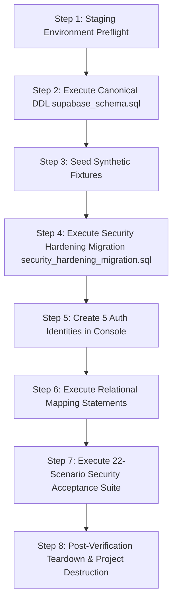
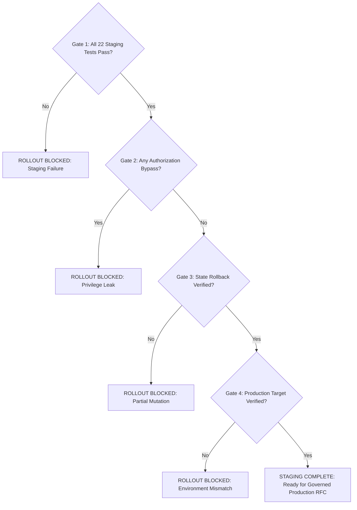

# IT Support Analytics — Disposable Supabase Staging Execution Runbook

**Document Version:** 1.0.0  
**Phase:** 05D.1 (Disposable Supabase Staging Runbook)  
**Status:** Plan Specified Locally; Pending Explicit Staging Provisioning Authorization  
**Target Codebase:** `it-support-analytics` (`kaustubh21112002/it-support-analytics`)  
**Governing Principle:** PRESERVE → DOCUMENT → FLAG → GOVERN  
**Canonical Local DDL Baseline:** `it_support_analytics_dataset/sql/supabase_schema.sql`  
**Security Migration Target:** `it_support_analytics_dataset/sql/security_hardening_migration.sql`  
**Automated Verification Toolkit:** `scripts/check-security-migration.mjs`  

---

## 1. Scope, Safety Interlocks & Prerequisites

> [!CAUTION]
> **MANDATORY SAFETY BOUNDARY: PRODUCTION IS STRICTLY OUT OF SCOPE**
> 
> 1. Under NO circumstances should any statement in this runbook, any DDL migration, or any mutation script be executed against the live production Supabase instance.
> 2. All staging activities MUST occur within an **isolated, temporary, disposable Supabase project** created specifically for this security verification exercise and destroyed immediately afterward.
> 3. Zero remote database operations or live credentials are created or used in Phase 05D.1. This document defines the **auditable plan only**.
> 4. Never commit, paste, log, or request real secrets (`SUPABASE_SERVICE_ROLE_KEY`, passwords, or session tokens) in chat, pull requests, or version control. All credentials must use generic environment variable placeholders.

### 1.1 Staging Environment Prerequisites

Before requesting authorization to provision a staging environment, confirm:

- [ ] **1. Disposable Project Isolation**: Project must be a brand new, empty Supabase project (e.g. `<DISPOSABLE_STAGING_PROJECT_REF>`), completely unlinked from production data or networks.
- [ ] **2. Engine Compatibility**: Database version must be **PostgreSQL 15+** (Supabase standard).
- [ ] **3. Service Availability**: PostgREST HTTPS API and Supabase Auth (Email provider) must be enabled and active.
- [ ] **4. Zero Sensitive Data**: Staging must contain exclusively synthetic data; zero live operational tickets, customer identifiers, or employee identities.
- [ ] **5. Temporary Credential Injection**: Staging credentials must be supplied exclusively through temporary shell environment variables:
  ```powershell
  # Temporary session variables (NEVER persist to disk or commit to .env)
  $env:SUPABASE_STAGING_URL = "https://<DISPOSABLE_STAGING_PROJECT_REF>.supabase.co"
  $env:SUPABASE_STAGING_KEY = "<STAGING_ANON_KEY>"
  $env:SUPABASE_STAGING_SERVICE_ROLE_KEY = "<STAGING_SERVICE_ROLE_KEY>"
  ```
- [ ] **6. Production URL Collision Interlock**: The automated verification toolkit (`scripts/check-security-migration.mjs`) inspects `.env.local`. If `$env:SUPABASE_STAGING_URL` matches the production URL, it immediately aborts with an exit code of 1 to prevent accidental execution against production.

---

## 2. Test Identities & Relational Mapping Setup

To evaluate the complete role-based and attribute-based access control matrix (Model C Hybrid Authorization), create 5 distinct test accounts in the disposable staging Supabase Auth Console (`Authentication` -> `Users` -> `Add User`):

### 2.1 Test Identity Profiles

| Persona Identity | Staging Email Address | Target Auth UUID Placeholder | Role in `public.user_roles` | Relational Entity Link | Intended Boundary |
| :--- | :--- | :--- | :--- | :--- | :--- |
| **Anonymous** | *(No session / Unauthenticated)* | `NULL` | None (`PUBLIC`, `anon`) | None | Public landing page only; zero ticket access. |
| **Ordinary Employee** | `test.employee@example.com` | `<EMPLOYEE_UUID>` | None (Defaults to `'authenticated'`) | None | Submits tickets; zero operational queue browsing. |
| **Support Agent Alpha** | `test.agent@example.com` | `<AGENT_ALPHA_UUID>` | `'agent'` | `public.agents.agent_id = 901` (`Team 991`) | Reads Team 991 queue; triages assigned/claimed tickets. |
| **Support Agent Beta (Peer)** | `test.agent_beta@example.com` | `<AGENT_BETA_UUID>` | `'agent'` | `public.agents.agent_id = 902` (`Team 992`) | Reads Team 992 queue; isolated from Agent Alpha. |
| **Operations Manager** | `test.manager@example.com` | `<MANAGER_UUID>` | `'manager'` | `public.team_managers` (`Team 991`) | Reassigns/triages within authorized Team 991. |
| **Governance Admin** | `test.admin@example.com` | `<ADMIN_UUID>` | `'admin'` | Global Authority | Full governance; manages dimensions and roles. |
| **Unmapped Agent (Test)** | `test.unmapped@example.com` | `<UNMAPPED_AGENT_UUID>` | `'agent'` | `user_id = NULL` (Unlinked agent) | Fail-closed gate test: 0 ticket rows; RPC denied. |

### 2.2 Administrative Setup Script (SQL Editor Execution)

After the 5 Auth accounts are created in the Supabase Auth console, execute the following configuration script in the disposable staging SQL Editor, substituting the actual auth UUIDs:

```sql
-- ============================================================================
-- STAGING TEST USER ROLE & RELATIONAL MAPPING SCRIPT
-- Execute in Disposable Staging SQL Editor after creating Auth accounts
-- ============================================================================
BEGIN;

-- 1. Populate authoritative user roles (public.user_roles)
INSERT INTO public.user_roles (user_id, role)
VALUES 
    ('<AGENT_ALPHA_UUID>', 'agent'),
    ('<AGENT_BETA_UUID>', 'agent'),
    ('<MANAGER_UUID>', 'manager'),
    ('<ADMIN_UUID>', 'admin'),
    ('<UNMAPPED_AGENT_UUID>', 'agent')
ON CONFLICT (user_id) DO UPDATE SET role = EXCLUDED.role;
-- Notice: <EMPLOYEE_UUID> is intentionally omitted to verify default 'authenticated' unprivileged behavior.

-- 2. Establish cryptographic agent-to-auth link (Model C Identity Mapping)
UPDATE public.agents 
SET user_id = '<AGENT_ALPHA_UUID>' 
WHERE agent_id = 901;

UPDATE public.agents 
SET user_id = '<AGENT_BETA_UUID>' 
WHERE agent_id = 902;
-- Notice: Agent 903 remains user_id = NULL to verify peer assignment without active auth user.

-- 3. Establish manager team authority mapping (public.team_managers)
INSERT INTO public.team_managers (user_id, team_id, assigned_by)
VALUES 
    ('<MANAGER_UUID>', 991, '<ADMIN_UUID>')
ON CONFLICT (user_id, team_id) DO NOTHING;
-- Notice: Manager is mapped strictly to Team 991; Team 992 remains unauthorized.

COMMIT;
```

---

## 3. Safe Synthetic Test Data Fixtures

To ensure zero leakage of production or PII data, the staging environment must be seeded exclusively with the following controlled synthetic fixtures:

```sql
-- ============================================================================
-- SAFE SYNTHETIC TEST FIXTURES
-- Execute in Disposable Staging SQL Editor after supabase_schema.sql
-- ============================================================================
BEGIN;

-- 1. Synthetic Dimension Records: Department & Teams
INSERT INTO public.departments (department_id, department_name)
VALUES (999, 'Staging Test Dept')
ON CONFLICT (department_id) DO NOTHING;

INSERT INTO public.teams (team_id, team_name, department_id)
VALUES 
    (991, 'Staging Team Alpha', 999),
    (992, 'Staging Team Beta', 999)
ON CONFLICT (team_id) DO NOTHING;

-- 2. Synthetic Agents (Matches Canonical Schema Contract)
INSERT INTO public.agents (agent_id, agent_code, agent_name, team_id, experience_band, is_active)
VALUES 
    (901, 'STG-001', 'Staging Agent Alpha', 991, 'Senior', TRUE),
    (902, 'STG-002', 'Staging Agent Beta', 992, 'Mid-level', TRUE),
    (903, 'STG-003', 'Staging Agent Gamma', 991, 'Junior', TRUE)
ON CONFLICT (agent_id) DO NOTHING;

-- 3. Synthetic SLA Rules
INSERT INTO public.sla_rules (sla_rule_id, priority, target_resolution_hours, description)
VALUES 
    (901, 'Critical', 4.0, 'Critical SLA - 4h turnaround'),
    (902, 'High', 8.0, 'High SLA - 8h turnaround'),
    (903, 'Medium', 24.0, 'Medium SLA - 24h turnaround'),
    (904, 'Low', 72.0, 'Low SLA - 72h turnaround')
ON CONFLICT (sla_rule_id) DO NOTHING;

-- 4. Synthetic Incident Fact Records
INSERT INTO public.tickets (
    ticket_id, created_at, status, priority, category_id, issue_type,
    department_id, team_id, agent_id, sla_rule_id
) VALUES 
    -- STG-00001: Unassigned ticket in Team Alpha queue (Target for self-claim and SEC-01 tests)
    ('STG-00001', CURRENT_TIMESTAMP - INTERVAL '2 hours', 'Open', 'Medium', 1, 'Unassigned Alpha Incident', 999, 991, NULL, 903),
    
    -- STG-00002: Assigned ticket in Team Beta queue (Target for cross-team isolation and manager boundaries)
    ('STG-00002', CURRENT_TIMESTAMP - INTERVAL '3 hours', 'Open', 'High', 1, 'Assigned Beta Incident', 999, 992, 902, 902),
    
    -- STG-00003: Peer-assigned ticket in Team Alpha queue (Target for peer mutation rejection)
    ('STG-00003', CURRENT_TIMESTAMP - INTERVAL '1 hour', 'Open', 'Critical', 1, 'Peer Assigned Incident', 999, 991, 903, 901)
ON CONFLICT (ticket_id) DO NOTHING;

COMMIT;
```

---

## 4. Step-by-Step Staging Migration Procedure

Follow this strict chronological procedure to initialize, migrate, and verify the disposable staging project:



### Step 1: Preflight Verification
Verify disposable staging connectivity and confirm that production is not targeted:
```powershell
# In PowerShell:
if ($env:SUPABASE_STAGING_URL -like "*<PRODUCTION_IDENTIFIER>*") {
    throw "ABORT: Staging URL matches production configuration!"
}
curl.exe -I -s "$env:SUPABASE_STAGING_URL/rest/v1/"
```

### Step 2: Base Canonical DDL Execution
In the Staging SQL Editor, execute the complete contents of:
`it_support_analytics_dataset/sql/supabase_schema.sql`
- Confirms: Types `ticket_status`, `ticket_priority`, `experience_level` created; tables `departments`, `categories`, `sla_rules`, `teams`, `agents`, `tickets` created.

### Step 3: Seed Synthetic Test Fixtures
In the Staging SQL Editor, execute the synthetic fixture script from **Section 3**.
- Confirms: 1 department, 2 teams, 3 agents, 4 SLA rules, 3 tickets inserted cleanly.

### Step 4: Apply Security Hardening Migration
In the Staging SQL Editor, execute the complete contents of:
`it_support_analytics_dataset/sql/security_hardening_migration.sql`
- Confirms:
  - Atomic `BEGIN; ... COMMIT;` wrapper commits without error.
  - Table `public.user_roles` and `public.team_managers` created.
  - Column `public.agents.user_id` added.
  - Functions `is_admin()`, `current_user_role()`, `current_agent_id()`, `current_agent_team_id()`, `is_team_manager()`, and `update_ticket_triage()` created and owned by `postgres`.
  - View `public.agent_directory` created in-place, owned by `postgres`, with default `security_invoker = false`.
  - Direct SQL `UPDATE` on `public.tickets` completely revoked from `authenticated`, `anon`, and `PUBLIC`.
  - `NOTIFY pgrst, 'reload schema'` fires on commit.

### Step 5: Provision Auth Identities
In the Supabase Dashboard, navigate to `Authentication` -> `Users` and create the 5 test accounts. Copy their generated UUIDs.

### Step 6: Execute Relational Mapping
In the Staging SQL Editor, substitute the UUIDs and execute the mapping script from **Section 2.2**.

### Step 7: Verify PostgREST Schema Cache Refresh
Verify that PostgREST has loaded the view and functions:
```powershell
curl.exe -s -H "apikey: $env:SUPABASE_STAGING_KEY" "$env:SUPABASE_STAGING_URL/rest/v1/agent_directory?limit=1"
```

---

## 5. Security Acceptance Matrix (STAGE-01 through STAGE-22)

Every scenario below must be executed in staging. For each test, record the execution output and confirm the data-integrity check.

| Test ID | Scenario & Target | Caller Identity | Executed Operation / Query | Expected Result (HTTP / SQLSTATE) | Data Integrity Check (State Rollback) | Evidence to Collect | Failure Response |
| :--- | :--- | :--- | :--- | :--- | :--- | :--- | :--- |
| **STAGE-01** | Anonymous Fact Read Denial | `anon` | `SELECT * FROM public.tickets LIMIT 5;` | **HTTP 401 / 42501 (0 rows)**: Permission denied or 0 rows returned. | Zero rows leaked to unauthenticated caller. | PostgREST HTTP response headers & body. | **BLOCK**: Revoke table SELECT from `anon`. |
| **STAGE-01B** | Anonymous Dimension Read | `anon` | `SELECT department_name FROM public.departments LIMIT 5;` | **HTTP 200 (1+ rows)**: Reference master records returned for UI navigation. | Dimension data remains read-only. | JSON response with department list. | **BLOCK**: Ensure SELECT granted to `anon` on dimensions. |
| **STAGE-02** | Anonymous Write Rejection | `anon` | `INSERT INTO public.departments (department_id, department_name) VALUES (998, 'Hack');` | **HTTP 401 / 42501**: Permission denied by PostgreSQL privilege layer. | Department 998 does NOT exist in table. | PostgreSQL 42501 error log. | **BLOCK**: Revoke INSERT from `anon` & `PUBLIC`. |
| **STAGE-03A** | Employee Cross-Ticket Denial | `test.employee` (`<EMPLOYEE_UUID>`) | `SELECT ticket_id, status FROM public.tickets;` | **HTTP 200 (0 rows)**: Returns 0 rows. Ordinary staff shielded from queue. | Zero operational ticket rows returned. | Query response showing `[]` (0 rows). | **BLOCK**: Eliminate permissive authenticated SELECT policies. |
| **STAGE-03B** | Employee Triage Rejection | `test.employee` (`<EMPLOYEE_UUID>`) | `SELECT public.update_ticket_triage('STG-00001', p_status => 'In Progress');` | **42501 Exception**: `Caller role authenticated is not permitted to triage tickets`. | `STG-00001` remains `Open` and unassigned. | RPC exception string & error code 42501. | **BLOCK**: Verify caller role check in RPC header. |
| **STAGE-04A** | Staff Operational Queue Read | `test.agent` (`<AGENT_ALPHA_UUID>`) | `SELECT ticket_id, team_id FROM public.tickets;` | **HTTP 200 (2 rows)**: Returns `STG-00001` and `STG-00003` (Team 991). Excludes `STG-00002` (Team 992). | Only caller's team tickets returned. | Query response showing exactly Team 991 tickets. | **BLOCK**: Check `sec_staff_select_tickets` policy. |
| **STAGE-04B** | Agent Valid Ticket Triage | `test.agent` (`<AGENT_ALPHA_UUID>`) | `SELECT public.update_ticket_triage('STG-00001', p_status => 'In Progress', p_agent_id => 901);` | **HTTP 200 (JSON)**: Mutation succeeds; ticket updated to `In Progress`, assigned to 901. | Ticket `STG-00001` has `status = 'In Progress'`, `agent_id = 901`. | Returning JSON representation of updated ticket. | **BLOCK**: Verify RPC execution grants and parameter logic. |
| **STAGE-05** | Inconsistent Team Rejection | `test.agent` (`<AGENT_ALPHA_UUID>`) | `SELECT public.update_ticket_triage('STG-00001', p_agent_id => 901, p_team_id => 992);` | **23514 / 42501 Exception**: `Inconsistent agent/team assignment` or `cannot move tickets across teams`. | Ticket remains assigned to Team 991; team unchanged. | RPC exception text & database state check. | **BLOCK**: Verify team alignment check in RPC. |
| **STAGE-06** | Invalid Status Rejection | `test.agent` (`<AGENT_ALPHA_UUID>`) | `SELECT public.update_ticket_triage('STG-00001', p_status => 'InvalidDraft');` | **22023 Exception**: `Invalid status "InvalidDraft". Permitted values: Open, In Progress, Pending, Resolved, Closed`. | Ticket status remains unchanged. | RPC exception text & transaction rollback log. | **BLOCK**: Verify status whitelist in RPC. |
| **STAGE-07** | Direct SQL UPDATE Rejection | `test.agent` (`<AGENT_ALPHA_UUID>`) | `UPDATE public.tickets SET status = 'Resolved' WHERE ticket_id = 'STG-00001';` | **42501 Error**: `permission denied for table tickets`. Direct UPDATE rejected. | Ticket status remains `In Progress` (bypassing RPC prevented). | Direct SQL execution error code 42501. | **BLOCK**: Ensure zero direct UPDATE grants exist. |
| **STAGE-08** | Dimension Immutability | `test.admin` (`<ADMIN_UUID>`) | Attempt direct update or RPC parameter smuggling altering `created_at` or `department_id`. | **42501 Error**: Historical analytical dimensions cannot be modified via RPC or table write. | `created_at` and `department_id` match initial seed exactly. | SQL update error log & record inspection. | **BLOCK**: Ensure RPC omits parameters for historical fields. |
| **STAGE-09** | Unauthorized RPC Execution | `anon` | Direct POST to `/rest/v1/rpc/update_ticket_triage` | **HTTP 401 / 42501**: `permission denied for function update_ticket_triage`. | Database state unaltered. | HTTP 401 response body. | **BLOCK**: Revoke function EXECUTE from `anon` & `PUBLIC`. |
| **STAGE-10** | Role Escalation Resistance | `test.employee` (`<EMPLOYEE_UUID>`) | `INSERT INTO public.user_roles (user_id, role) VALUES ('<EMPLOYEE_UUID>', 'admin');` | **42501 Error**: RLS policy `sec_admin_manage_user_roles` blocks write. | No row for employee inserted into `user_roles`. | PostgreSQL 42501 error log. | **BLOCK**: Ensure `user_roles` RLS checks `is_admin()`. |
| **STAGE-11** | Admin Dimension Management | `test.admin` vs `test.agent` | `INSERT INTO public.departments (department_id, department_name) VALUES (997, 'New Dept');` | **Admin succeeds (HTTP 201)**; **Agent fails (42501)** via RLS `sec_admin_manage_departments`. | Only admin can add master dimensions. | HTTP 201 response for admin; 403 for agent. | **BLOCK**: Check RLS write policies on dimension tables. |
| **STAGE-12** | Dynamic Role Revocation | `test.agent` (Demoted) | Delete role from `public.user_roles`, then immediately invoke `update_ticket_triage`. | **42501 Exception**: Immediately rejected on subsequent request with zero lag. | Second triage call rejected; ticket unchanged. | Error response from post-revocation call. | **BLOCK**: Ensure role helper queries table dynamically. |
| **STAGE-13** | Agent Queue Isolation | `test.agent` (`<AGENT_ALPHA_UUID>`) | `SELECT count(*) FROM public.tickets WHERE team_id = 992;` | **HTTP 200 (0 rows)**: Returns 0. Tickets belonging to Team 992 shielded by RLS. | Zero foreign team tickets visible to Agent Alpha. | Query result showing count = 0. | **BLOCK**: Verify `team_id = current_agent_team_id()`. |
| **STAGE-14** | Agent Claim in Own Team | `test.agent` (`<AGENT_ALPHA_UUID>`) | Claim unassigned ticket: `SELECT public.update_ticket_triage('STG-00001', p_agent_id => 901);` | **HTTP 200 (JSON)**: Self-assignment succeeds; ticket assigned to Agent 901 in Team 991. | `STG-00001` has `agent_id = 901`. | Returning JSON representation confirming 901. | **BLOCK**: Verify claim invariant allows self-claim. |
| **STAGE-15** | Peer Mutation Rejection | `test.agent` (`<AGENT_ALPHA_UUID>`) | Mutate ticket assigned to Agent 903: `SELECT public.update_ticket_triage('STG-00003', p_status => 'In Progress');` | **42501 Exception**: `Unauthorized: Ticket is assigned to peer Agent 903. Mutation prohibited`. | `STG-00003` remains `status = 'Open'`, `agent_id = 903`. | RPC exception string & error code 42501. | **BLOCK**: Verify peer rejection gate in RPC. |
| **STAGE-16** | Cross-Team Move Rejection | `test.agent` (`<AGENT_ALPHA_UUID>`) | Move ticket to Team 992: `SELECT public.update_ticket_triage('STG-00001', p_team_id => 992);` | **42501 Exception**: `Unauthorized: Agents cannot move tickets across teams`. | Ticket team remains 991. | RPC exception text & database state check. | **BLOCK**: Verify cross-team move check for agents. |
| **STAGE-17** | Manager Scoped Authority | `test.manager` (`<MANAGER_UUID>`) | Triage in authorized Team 991 (allowed) vs unauthorized Team 992 (denied). | **Team 991 succeeds**; **Team 992 raises 42501**: `Manager lacks authority over Team 992`. | Team 991 ticket updated; Team 992 ticket untouched. | Success JSON for 991; 42501 error for 992. | **BLOCK**: Verify `is_team_manager(team_id)` in RPC. |
| **STAGE-18** | Unmapped Agent Fail-Closed | `test.unmapped` (`<UNMAPPED_AGENT_UUID>`) | Attempt queue read and triage call. | **HTTP 200 (0 rows)** on queue read; **42501 Exception**: `Caller is not mapped to an active agent record`. | Unmapped caller denied all operational access. | 0 rows on SELECT; 42501 on RPC call. | **BLOCK**: Verify `v_caller_agent_id IS NULL` check. |
| **STAGE-19** | SEC-01 Unassigned Guardrail | `test.agent` (`<AGENT_ALPHA_UUID>`) | Update unassigned ticket with `p_unassign_agent => TRUE` or without claim. | **42501 Exception**: `Agents cannot unassign an unassigned ticket; Agent must claim unassigned ticket`. | Ticket remains `Open` and unassigned (`NULL`). | RPC exception text & database inspection. | **BLOCK**: Enforce SEC-01 unassigned claim invariant. |
| **STAGE-20** | SEC-02 Identity Shielding | `anon` & `test.employee` | `SELECT * FROM public.agent_directory;` vs `SELECT user_id FROM public.agents;` | **agent_directory returns 3 rows without user_id**; base `agents` table SELECT denied (42501 for anon, 0 rows for employee). | `user_id` column completely inaccessible to unprivileged clients. | Column listing showing zero `user_id`; base table error. | **BLOCK**: Exclude `user_id` from view; lock down base table. |
| **STAGE-21** | View Replacement Safety | All 5 Roles | Execute Section 3.1 verification queries; inspect owner (`postgres`), `security_invoker = false`, hydration. | **HTTP 200 across all 5 roles on agent_directory**; base table denied to non-admins; client hydration succeeds. | View definition intact; 7 columns match canonical contract. | Verification SQL output & hydration test result. | **BLOCK**: Verify `ALTER VIEW ... OWNER TO postgres;`. |
| **STAGE-22** | Migration Rerun Idempotency | Superuser / Deployment Admin (`postgres`) | Execute `security_hardening_migration.sql` a second time against migrated staging database. | **Transaction commits cleanly with ZERO errors**; all existing tables, roles, and tickets remain intact; `NOTIFY pgrst` refreshes schema cache. | Record counts and table structure identical before and after second run. | Migration execution output showing success. | **BLOCK**: Verify idempotent `IF NOT EXISTS` / `CREATE OR REPLACE` syntax. |

---

## 6. Mandatory Execution Gates & Hard Boundaries

The following hard boundaries must be enforced by the deployment engineer. Any violation immediately halts deployment:



1. **Gate 1: Complete Staging Pass Requirement**:
   - Zero production rollout authorization will be granted until **all 22 staging tests pass** with verifiable evidence.
2. **Gate 2: Zero Tolerance for Authorization Failures**:
   - Any failure in authorization (e.g. an unmapped agent viewing tickets, or an agent modifying a peer's ticket) constitutes a **hard stop**.
3. **Gate 3: Static Pass != Runtime Proof**:
   - Passing local heuristic tests (`check-security-migration.mjs` or `test-ticket-persistence.mjs`) is necessary but **never sufficient** to declare security verification complete. Only live execution against disposable staging constitutes runtime proof.
4. **Gate 4: Rejected Mutation State Rollback**:
   - For every rejected mutation test (`STAGE-03B`, `STAGE-05`, `STAGE-06`, `STAGE-07`, `STAGE-15`, `STAGE-16`, `STAGE-19`), verify that the target database row was **not partially altered**. The transaction must rollback completely.
5. **Gate 5: Prohibition Against Weakening Authorization**:
   - If a test fails because legitimate staff cannot perform an operation, the remediation must NEVER involve adding permissive policies (e.g. `USING (true)`) or granting direct table `UPDATE`. The remediation must fix the specific helper function or RPC boundary.
6. **Gate 6: Prohibition of Historical Rollback Scripts**:
   - Do NOT use historical rollback SQL scripts that re-create `"Allow public read-only access"` or execute `DROP TABLE public.user_roles`. Re-opening public access to operational tickets is strictly prohibited.

---

## 7. Stop Conditions & Failure Handling Protocol

### 7.1 Immediate Stop Conditions
Halt staging execution immediately upon encountering any of the following triggers:

1. **Production Collision**: `$env:SUPABASE_STAGING_URL` matches the production project URL in `.env.local`.
2. **Transaction Abortion**: `security_hardening_migration.sql` fails to commit, encounters syntax errors, or throws SQLSTATE errors during DDL execution.
3. **Direct UPDATE Permitted**: Direct SQL `UPDATE public.tickets` succeeds from an authenticated client session, bypassing the RPC.
4. **Peer Mutation Permitted**: Support Agent Alpha successfully alters status or priority on Agent Beta's ticket.
5. **Unassigned Triage Without Claim**: Support Agent Alpha successfully updates status or priority on an unassigned ticket while leaving it unassigned (`p_unassign_agent => TRUE`).
6. **Identity Leakage**: Querying `public.agent_directory` returns column `user_id`.

### 7.2 Failure Remediation Protocol: Destroy & Re-provision
If any migration or security test fails during staging verification:

> [!CAUTION]
> **NEVER ATTEMPT AD-HOC DATABASE PATCHING ON A CORRUPTED STAGING INSTANCE**
> 
> 1. Ad-hoc `ALTER`, `DROP`, or `GRANT` statements introduce schema drift and unrecorded side-effects.
> 2. The **mandatory recovery procedure** is to **destroy the disposable staging database** (or drop all tables) and re-provision from scratch.
> 3. Fix the local source files (`supabase_schema.sql`, `security_hardening_migration.sql`), re-verify all 41 local static checks, and restart from **Step 1** of the runbook.

---

## 8. Post-Verification Environment Teardown Protocol

Once all 22 staging tests pass and evidence has been recorded in the deployment log:

1. **Delete Auth Test Users**:
   - In Supabase Dashboard -> `Authentication` -> `Users`, delete all 5 test accounts (`test.employee`, `test.agent`, `test.agent_beta`, `test.manager`, `test.admin`, `test.unmapped`).
2. **Purge Database Objects**:
   - In the Staging SQL Editor, drop the staging schema objects:
     ```sql
     DROP VIEW IF EXISTS public.agent_directory;
     DROP TABLE IF EXISTS public.team_managers, public.user_roles, public.tickets, public.agents, public.teams, public.sla_rules, public.categories, public.departments CASCADE;
     DROP FUNCTION IF EXISTS public.update_ticket_triage, public.is_team_manager, public.current_agent_team_id, public.current_agent_id, public.current_user_role, public.is_admin CASCADE;
     ```
3. **Delete Disposable Staging Project**:
   - In the Supabase Organization Dashboard, permanently delete the temporary project `<DISPOSABLE_STAGING_PROJECT_REF>`.
4. **Purge Temporary Environment Variables**:
   ```powershell
   Remove-Item Env:SUPABASE_STAGING_URL -ErrorAction SilentlyContinue
   Remove-Item Env:SUPABASE_STAGING_KEY -ErrorAction SilentlyContinue
   Remove-Item Env:SUPABASE_STAGING_SERVICE_ROLE_KEY -ErrorAction SilentlyContinue
   ```
5. **Compile Evidence Summary**:
   - Record the test execution logs, HTTP responses, and timestamped evidence in the Phase 05D verification archive before requesting production RFC review.
