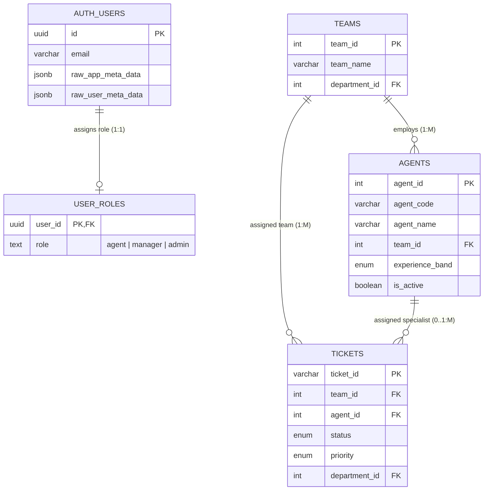
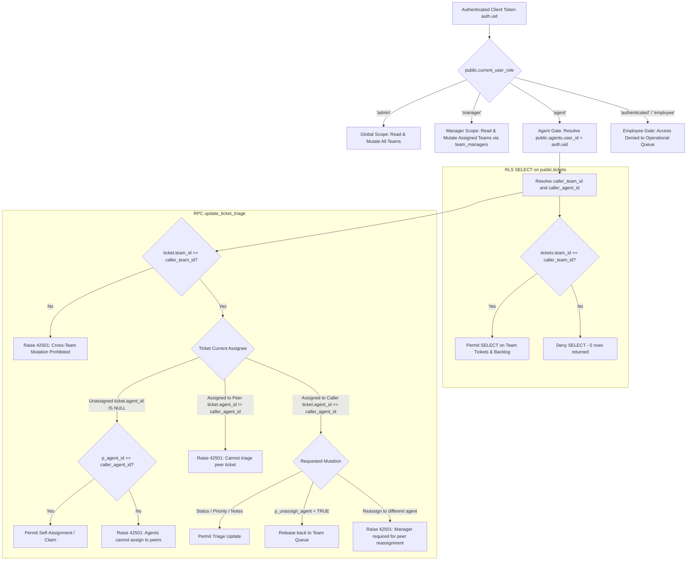
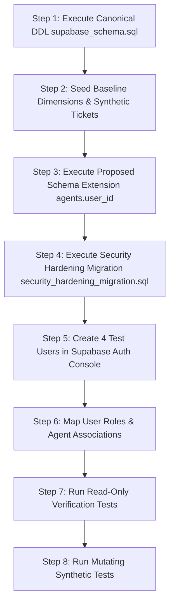

# IT Support Analytics — Staging Readiness & Agent Authorization Specification

**Document Version:** 1.2.0  
**Phase:** 05C.6 (Targeted RPC and Agent-Directory Security Fixes)  
**Status:** Implemented Locally in Canonical DDL, Security Migration & Client Layer (All Schema Changes Local and Unapplied; No Staging Project Provisioned; Remote Database Execution Prohibited)  
**Canonical Local DDL Baseline:** `it_support_analytics_dataset/sql/supabase_schema.sql`  
**Security Migration Target:** `it_support_analytics_dataset/sql/security_hardening_migration.sql`  

---

## 1. Executive Summary & Purpose

This document provides the canonical specification for:
1. **The Current Authorization Topology**: Mapping the relational relationships and critical identity gaps between Supabase Auth identities (`auth.users`), role assignments (`public.user_roles`), and support personnel (`public.agents`).
2. **Least-Privilege Agent Authorization Design**: Formally evaluating access control architectures and recommending **Model C (Hybrid Team-Queue Visibility with Assigned-Ticket Triage Enforcement)**.
3. **Implemented Local Schema Additions**: Non-destructive SQL additions implemented locally in canonical DDL (`supabase_schema.sql`) and security migration (`security_hardening_migration.sql`), ready for future staging deployment.
4. **Administrative User-Agent Mapping & Lifecycle Protocol**: Exact administrative procedures for creating, updating, and revoking user-to-agent and team-manager links without automated or self-escalation risks.
5. **Comprehensive 12-Scenario Authorization Test Matrix**: Specification of test fixtures, identities, requests, and expected database behaviors for future staging verification.
6. **Disposable Staging Readiness Protocol**: An operational preflight checklist, initialization sequence, synthetic seeding strategy, and stop-and-recreate lifecycle for disposable testing environments.

---

## 2. Current Authorization Model Mapping & Identity Gap Analysis

### 2.1 Entity Relationship & Identity Topology

The existing codebase and proposed security migration define the following authorization entities:



### 2.2 Traceability Matrix Across System Entities

| Entity / Column | Source Definition | Relationship to Caller (`auth.uid()`) | Current Enforcement Role | Security & Governance Finding |
| :--- | :--- | :--- | :--- | :--- |
| `auth.users.id` | Supabase Auth Engine | Cryptographic identity (`auth.uid()`). | Authenticated session token subject. | Immutable server-verified caller identity. |
| `public.user_roles.user_id` | `security_hardening_migration.sql:89` | 1:1 Foreign Key (`REFERENCES auth.users(id)`). | Evaluated by `current_user_role()` and `is_admin()`. | Authoritative role source. **Contains NO team, agent, or department link.** |
| `public.agents.agent_id` | `supabase_schema.sql:102` | **NO RELATIONSHIP** to `auth.users(id)`. | Assigned specialist dimension ($1\text{--}24$). | **CRITICAL IDENTITY GAP**: Zero database foreign keys link an auth user to an agent record. Numeric IDs (e.g. 1) do not map to UUIDs. |
| `public.agents.team_id` | `supabase_schema.sql:110` | M:1 FK (`REFERENCES teams(team_id)`). | Enforces agent's parent support team ($1\text{--}8$). | Relational constraint exists, but caller's parent team cannot be determined by the database. |
| `public.tickets.agent_id` | `supabase_schema.sql:134` | Nullable FK (`REFERENCES agents(agent_id)`). | Identifies current assigned support specialist. | Null indicates unassigned queue. Database cannot verify if caller is `agent_id`. |
| `public.tickets.team_id` | `supabase_schema.sql:133` | NOT NULL FK (`REFERENCES teams(team_id)`). | Identifies assigned operational support team. | Validated against `agents.team_id` by RPC, but caller's team boundary is unenforced. |

### 2.3 Identity Gaps in Current Implementation

1. **Absence of Agent User Mapping in Database**:
   - `public.agents` currently lacks a `user_id UUID REFERENCES auth.users(id)` column.
   - The database engine cannot verify whether `auth.uid()` corresponds to `p_agent_id` or `tickets.agent_id`.
2. **Global Staff Read Access**:
   - Under `sec_staff_select_tickets` (`security_hardening_migration.sql:703`), any authenticated user with role `'agent'`, `'manager'`, or `'admin'` can read **all 8,000 tickets** across all 8 teams and all 5 departments.
3. **Broad Staff Triage Scope**:
   - In `public.update_ticket_triage` (`security_hardening_migration.sql:418`), the RPC verifies that the caller has a staff role (`'agent'`, `'manager'`, `'admin'`). It validates that `p_agent_id` belongs to `v_agent_team_id`, but it does **not** restrict an agent from modifying tickets belonging to other teams or peer agents.
4. **Client-Editable Metadata Vulnerability in UI**:
   - In `src/context/AuthContext.tsx:91`, `agentId` is extracted from `sbUser.user_metadata?.agent_id`. Because `user_metadata` can be mutated by users via `supabase.auth.updateUser()`, it is purely presentational and cannot be used as an authorization boundary.

---

## 3. Least-Privilege Agent Authorization Design

### 3.1 Architectural Policy Comparison

We evaluate three operational access models for IT support agents:

| Evaluation Dimension | Model A: Assigned-Ticket Access | Model B: Team-Queue Access | Model C: Hybrid (Recommended) |
| :--- | :--- | :--- | :--- |
| **Description** | Agent can read and mutate ONLY tickets directly assigned to their verified `agent_id`. | Agent can read all tickets in their team's queue and triage any ticket within the team. | Agent can **read** their team's queue (including unassigned tickets), but can **mutate** only tickets assigned to them or self-assign unassigned tickets. |
| **Queue Visibility** | Severely restricted. Agent cannot view the team backlog, incoming work, or peer workload. | Full team queue visibility. | Full team queue visibility. Agents see team workload and at-risk SLA countdowns. |
| **Unassigned Tickets** | **Invisible to agents.** Requires manual manager dispatch for every ticket. | Agents can view and mutate any unassigned team ticket. | Agents can view unassigned team tickets and **claim them** (self-assignment). |
| **Reassignment Boundary** | Agent cannot reassign tickets to peers or release tickets back to queue. | Any agent can reassign peer tickets within the team. | Reassignment to peers requires **Manager/Admin** role. Agents can unassign their own ticket back to the team queue. |
| **Risk of Peer Conflict** | None (siloed). | High. Agents can overwrite peer notes, close peer tickets, or shuffle assignments. | Zero peer conflict. Agents cannot modify peer tickets. |
| **Operational Fit** | Poor. Unusable for modern ITIL tier-1/tier-2 dispatch and collaboration. | Moderate. Lacks internal team accountability and audit boundaries. | **Optimal.** Reconciles team situational awareness with strict individual mutation accountability. |

### 3.2 Detailed Architecture of Model C (Hybrid Model)



### 3.3 Core Invariants of Model C

1. **Trustworthy Identity Resolution**:
   - `public.current_agent_id()` resolves `public.agents.agent_id` where `user_id = auth.uid()`.
   - `public.current_agent_team_id()` resolves `public.agents.team_id` where `user_id = auth.uid()`.
   - Zero reliance on client-provided IDs, request headers, or `user_metadata`.
2. **Read Scoping (RLS `sec_staff_select_tickets`)**:
   - Administrators read all tickets.
   - Managers read tickets where `tickets.team_id IN (SELECT team_id FROM public.team_managers WHERE user_id = auth.uid())`.
   - Agents read tickets where `tickets.team_id = public.current_agent_team_id()`.
   - Ordinary employees receive 0 rows on operational tickets.
3. **Write Scoping (`public.update_ticket_triage`)**:
   - Direct `UPDATE` remains completely revoked on `public.tickets` across all client roles.
   - The RPC evaluates caller identity dynamically using `auth.uid()`.
   - Prevents cross-team reassignment (`p_team_id <> v_caller_team_id` raises SQLSTATE `42501`).
   - Prevents peer ticket modification (raises SQLSTATE `42501`).
   - Allows self-assignment of unassigned team tickets.
   - Allows agents to unassign their own tickets back to the team queue.
4. **Managerial Scoping**:
   - Managers are linked to one or more teams via `public.team_managers (user_id, team_id)`.
   - Managers can reassign tickets between any active agents in their managed team(s).
5. **Administrator Governance**:
   - Administrators retain global oversight across all teams, categories, and agents.

---

## 4. Local Schema Additions & Identity Mapping Implementation (Local-Only — Unapplied Remotely)

In Phase 05C.4, the Model C Hybrid authorization schema was implemented locally in the codebase:
- `user_id UUID UNIQUE REFERENCES auth.users(id) ON DELETE SET NULL` added to `public.agents` in canonical DDL (`it_support_analytics_dataset/sql/supabase_schema.sql`).
- `agents.user_id`, `public.team_managers`, scoping helpers (`current_agent_id`, `current_agent_team_id`, `is_team_manager`), Model C RLS on `public.tickets`, and deep RPC validation added to `it_support_analytics_dataset/sql/security_hardening_migration.sql`.

> [!IMPORTANT]
> **LOCAL-ONLY STATUS**: These additions are implemented in repository source files and validated through offline static checks. They have **NOT** been executed against any remote database. Staging is not yet provisioned.

```sql
-- =====================================================================
-- IMPLEMENTED SCHEMA EXTENSION: Least-Privilege Agent & Manager Mapping
-- LOCATION: it_support_analytics_dataset/sql/security_hardening_migration.sql
-- SAFE EXECUTION: Non-destructive, additive DDL. Contains NO DROP or DELETE.
-- =====================================================================

BEGIN;

-- ---------------------------------------------------------------------
-- 1. Link Canonical Agents to Supabase Auth Users
-- ---------------------------------------------------------------------
ALTER TABLE public.agents 
    ADD COLUMN IF NOT EXISTS user_id UUID UNIQUE REFERENCES auth.users(id) ON DELETE SET NULL;

CREATE INDEX IF NOT EXISTS idx_agents_user_id ON public.agents(user_id);

-- ---------------------------------------------------------------------
-- 2. Multi-Team Manager Authorization Table
-- ---------------------------------------------------------------------
CREATE TABLE IF NOT EXISTS public.team_managers (
    user_id UUID NOT NULL REFERENCES auth.users(id) ON DELETE CASCADE,
    team_id INTEGER NOT NULL REFERENCES public.teams(team_id) ON DELETE CASCADE,
    assigned_at TIMESTAMPTZ NOT NULL DEFAULT CURRENT_TIMESTAMP,
    assigned_by UUID REFERENCES auth.users(id),
    PRIMARY KEY (user_id, team_id)
);

ALTER TABLE public.team_managers ENABLE ROW LEVEL SECURITY;
REVOKE ALL ON TABLE public.team_managers FROM anon, PUBLIC;
GRANT SELECT, INSERT, UPDATE, DELETE ON TABLE public.team_managers TO authenticated;

-- Policies for team_managers (Management strictly gated to verified administrators)
CREATE POLICY "sec_users_select_own_manager_teams"
    ON public.team_managers FOR SELECT TO authenticated
    USING (auth.uid() = user_id OR public.is_admin());

CREATE POLICY "sec_admin_manage_team_managers"
    ON public.team_managers FOR ALL TO authenticated
    USING (public.is_admin())
    WITH CHECK (public.is_admin());

-- ---------------------------------------------------------------------
-- 3. Cryptographic Identity & Scope Helper Functions
-- ---------------------------------------------------------------------
CREATE OR REPLACE FUNCTION public.current_agent_id()
RETURNS INTEGER
LANGUAGE plpgsql
STABLE
SECURITY DEFINER
SET search_path = pg_catalog, pg_temp
AS $$
DECLARE
    v_uid UUID;
    v_role TEXT;
    v_agent_id INTEGER;
BEGIN
    v_uid := auth.uid();
    IF v_uid IS NULL THEN
        RETURN NULL;
    END IF;

    v_role := public.current_user_role();
    IF v_role NOT IN ('agent', 'manager', 'admin') THEN
        RETURN NULL;
    END IF;

    SELECT a.agent_id INTO v_agent_id
    FROM public.agents a
    WHERE a.user_id = v_uid
      AND a.is_active = TRUE;

    RETURN v_agent_id;
END;
$$;

ALTER FUNCTION public.current_agent_id() OWNER TO postgres;
REVOKE ALL ON FUNCTION public.current_agent_id() FROM PUBLIC, anon;
GRANT EXECUTE ON FUNCTION public.current_agent_id() TO authenticated, service_role;

CREATE OR REPLACE FUNCTION public.current_agent_team_id()
RETURNS INTEGER
LANGUAGE plpgsql
STABLE
SECURITY DEFINER
SET search_path = pg_catalog, pg_temp
AS $$
DECLARE
    v_uid UUID;
    v_role TEXT;
    v_team_id INTEGER;
BEGIN
    v_uid := auth.uid();
    IF v_uid IS NULL THEN
        RETURN NULL;
    END IF;

    v_role := public.current_user_role();
    IF v_role NOT IN ('agent', 'manager', 'admin') THEN
        RETURN NULL;
    END IF;

    SELECT a.team_id INTO v_team_id
    FROM public.agents a
    WHERE a.user_id = v_uid
      AND a.is_active = TRUE;

    RETURN v_team_id;
END;
$$;

ALTER FUNCTION public.current_agent_team_id() OWNER TO postgres;
REVOKE ALL ON FUNCTION public.current_agent_team_id() FROM PUBLIC, anon;
GRANT EXECUTE ON FUNCTION public.current_agent_team_id() TO authenticated, service_role;

CREATE OR REPLACE FUNCTION public.is_team_manager(p_team_id INTEGER)
RETURNS BOOLEAN
LANGUAGE plpgsql
STABLE
SECURITY DEFINER
SET search_path = pg_catalog, pg_temp
AS $$
DECLARE
    v_uid UUID;
    v_role TEXT;
BEGIN
    v_uid := auth.uid();
    IF v_uid IS NULL OR p_team_id IS NULL THEN
        RETURN FALSE;
    END IF;

    v_role := public.current_user_role();
    IF v_role NOT IN ('manager', 'admin') THEN
        RETURN FALSE;
    END IF;

    -- Administrators have global managerial authority
    IF v_role = 'admin' THEN
        RETURN TRUE;
    END IF;

    -- Operations managers require explicit team assignment
    RETURN EXISTS (
        SELECT 1 
        FROM public.team_managers tm
        WHERE tm.user_id = v_uid
          AND tm.team_id = p_team_id
    );
END;
$$;

ALTER FUNCTION public.is_team_manager(INTEGER) OWNER TO postgres;
REVOKE ALL ON FUNCTION public.is_team_manager(INTEGER) FROM PUBLIC, anon;
GRANT EXECUTE ON FUNCTION public.is_team_manager(INTEGER) TO authenticated, service_role;

COMMIT;
```

### 4.1 Schema Impact & Migration Considerations

1. **Why It Is Needed**:
   - Resolves the identity boundary gap without breaking existing analytical schemas.
   - Provides a relational anchor connecting Supabase Auth session tokens (`auth.uid()`) to relational dimension entities.
2. **Constraints & Foreign Keys**:
   - `user_id UUID UNIQUE REFERENCES auth.users(id) ON DELETE SET NULL`: Ensures 1:1 agent mapping while protecting historical ticket attribution if a user account is deleted.
   - `team_managers (user_id, team_id)`: Composite primary key with cascade deletion when users or teams are removed.
3. **Handling of Existing Data**:
   - The 24 historical agents from `agents.csv` initialize with `user_id = NULL`.
   - Historical tickets attributed to Agent 1..24 remain 100% valid for BI aggregation and reporting.
   - New live mutations require an explicit administrative mapping associating staging auth UUIDs with agent records.
4. **Behavior for Unmapped Users or Agents**:
   - Unmapped agents (`user_id IS NULL`) cannot authenticate or execute RPC triage mutations.
   - Unmapped authenticated users default to role `'authenticated'` (unprivileged employee) with zero operational ticket access.
5. **Migration Ordering**:
   - Phase 1: Apply baseline canonical DDL (`supabase_schema.sql`).
   - Phase 2: Apply proposed schema extension (`ALTER TABLE public.agents ADD COLUMN user_id ...`, `team_managers`).
   - Phase 3: Apply updated security migration with Model C RLS policies and hardened RPC.
   - Phase 4: Seed test auth accounts and associate `user_id` values.
6. **DDL Target Allocation**:
   - `user_id` on `agents` is incorporated into canonical `supabase_schema.sql`.
   - `team_managers`, helper functions, RLS policies, and RPC reside in `security_hardening_migration.sql`.

### 4.2 Administrative User-Agent Mapping & Lifecycle Protocol

To govern identity mappings in a future disposable staging environment, administrators must follow this strict operational protocol:

1. **Explicit Association (Zero Auto-Mapping)**:
   - Existing agents remain unmapped (`user_id = NULL`) until explicitly associated by an administrator.
   - Auto-mapping by email address matching, username matching, or numeric ID coincidence is strictly prohibited because email addresses and metadata can change and are not cryptographic identity anchors.
   - Explicit SQL assignment statement:
     ```sql
     -- Administrator executes in Staging SQL Editor:
     UPDATE public.agents
     SET user_id = '<STAGING_AUTH_UUID>'
     WHERE agent_id = <CANONICAL_AGENT_ID>;
     ```
2. **Anti Self-Escalation Safeguards**:
   - Support agents cannot map themselves to agent records or alter existing mappings.
   - Client roles have zero `INSERT`, `UPDATE`, or `DELETE` grants on `public.agents`.
   - `public.team_managers` is governed by RLS policy `sec_admin_manage_team_managers`, which strictly requires `public.is_admin()`. Authenticated non-admin users cannot insert or modify manager-team assignments.
3. **Agent Deactivation Lifecycle**:
   - When an agent departs or is suspended, an administrator sets `is_active = FALSE` in `public.agents`:
     ```sql
     UPDATE public.agents SET is_active = FALSE WHERE agent_id = <AGENT_ID>;
     ```
   - Scoping functions `current_agent_id()` and `current_agent_team_id()` filter strictly on `is_active = TRUE`.
   - Deactivated agents immediately fail closed on their next request: `sec_staff_select_tickets` returns 0 rows, and `update_ticket_triage` raises exception:
     `"Unauthorized: Caller is not mapped to an active agent record"` (ERRCODE `42501`).
4. **Mapping Revocation & Account Deletion**:
   - Setting `user_id = NULL` immediately removes the operational linkage:
     ```sql
     UPDATE public.agents SET user_id = NULL WHERE agent_id = <AGENT_ID>;
     ```
   - If an authenticated account is deleted from `auth.users`, the foreign key constraint `ON DELETE SET NULL` on `agents.user_id` automatically sets `user_id = NULL`.
5. **Preservation of Historical Ticket Attribution**:
   - Historical tickets in `public.tickets` store the canonical integer `agent_id` ($1\text{--}24$), NOT the auth UUID.
   - Deleting an auth user, revoking a mapping, or deactivating an agent does NOT alter or erase historical ticket attribution, turnaround hours, or SLA compliance metrics. All 8,000 reference records remain fully intact for BI reporting.
6. **Zero Credentials Boundary**:
   - No real users, passwords, API keys, or staging credentials have been created in this phase. All work is purely local and structural.

### 4.3 Public-Safe Agent Directory Projection (SEC-02 Identity Shielding)

To eliminate the potential exposure of support personnel auth UUIDs (`agents.user_id`) to anonymous visitors or unauthorized authenticated users:

1. **Architecture of `public.agent_directory`**:
   - A dedicated public projection view is defined in canonical DDL (`supabase_schema.sql`) and the hardening migration (`security_hardening_migration.sql`):
     ```sql
     CREATE OR REPLACE VIEW public.agent_directory AS
     SELECT
         agent_id,
         agent_code,
         agent_name,
         team_id,
         experience_band,
         is_active,
         created_at
     FROM public.agents;
     ALTER VIEW public.agent_directory OWNER TO postgres;
     ```
   - **Exclusion of `user_id`**: The view projection physically omits `user_id`. Even with `SELECT *` or explicit column parameters, PostgREST cannot return `user_id` through this endpoint.
2. **Effective SQL Grants & Base Table Protection**:
   - `GRANT SELECT ON TABLE public.agent_directory TO anon, authenticated;` provides safe directory reads for dashboards, filter lookups, and queue headers.
   - `REVOKE SELECT ON TABLE public.agents FROM anon;` completely blocks unauthenticated requests from inspecting the base `agents` table.
   - Permissive policies `sec_anon_select_agents` and `sec_auth_select_agents` (`USING (true)`) are dropped.
   - Base table RLS is restricted strictly to administrators:
     ```sql
     CREATE POLICY "sec_admin_manage_agents"
         ON public.agents FOR ALL TO authenticated
         USING (public.is_admin())
         WITH CHECK (public.is_admin());
     ```
   - Non-admin authenticated callers (`agent`, `manager`, `employee`) receive 0 rows if querying base `public.agents`.
   - Security definer helpers (`current_agent_id()`, `current_agent_team_id()`) execute as table owner `postgres`, retaining internal access to `user_id` without exposing it to client queries.
3. **Application Integration & Fallback Hardening (`src/services/dataService.ts`)**:
   - Preferred query uses explicit public directory columns:
     ```ts
     supabase.from('agent_directory').select('agent_id, agent_code, agent_name, team_id, experience_band, is_active, created_at')
     ```
   - Defensive fallback queries base `agents` table using explicit safe columns and **NEVER `select('*')`**:
     ```ts
     supabase.from('agents').select('agent_id, agent_code, team_id, experience_band')
     ```
   - Internal identity mapping `user_id` is strictly excluded from all client query projections.
   - **Strict Fallback Error Discriminator**:
     - Authorization failures (`ERRCODE 42501`, HTTP 401, HTTP 403, "permission denied") **never trigger fallback** and fail closed.
     - Abort, timeout, and network errors **never trigger fallback**.
     - Fallback triggers **only on genuine missing-view conditions** (`ERRCODE 42P01`, PostgREST schema cache misses `PGRST200`/`PGRST205`).
4. **PostgreSQL View Security Execution Model & Assumption**:
   - `public.agent_directory` is owned by `postgres` (`ALTER VIEW public.agent_directory OWNER TO postgres;`).
   - The security design assumes standard PostgreSQL default view execution semantics (owner privileges, `security_invoker = false`). Because the view owner is `postgres` (superuser), PostgREST can serve safe directory columns to `anon` and `authenticated` callers without requiring table grants or RLS permissions on the underlying `public.agents` table.
   - **Configuration Assumption**: The staging database must NOT specify `WITH (security_invoker = true)` on `public.agent_directory`. If `security_invoker = true` were specified, PostgreSQL would evaluate caller privileges against `public.agents`, causing non-admin reads to return 0 rows.
5. **Upgrade-Path Column Integrity**:
   - In `security_hardening_migration.sql`, `ALTER TABLE public.agents ADD COLUMN IF NOT EXISTS agent_name VARCHAR(100)`, `is_active BOOLEAN DEFAULT TRUE`, and `created_at TIMESTAMPTZ DEFAULT CURRENT_TIMESTAMP` are executed before view creation.
   - This ensures that if migrating from an older or partial schema where `agent_name` or timestamp columns were omitted, the view creation succeeds idempotently on both fresh schemas and upgrade paths.
6. **View Replacement Safety & Privilege Preservation Invariants (Phase 05C.9)**:
   - **`CREATE OR REPLACE VIEW` Preferred Over `DROP VIEW`**:
     - In PostgreSQL, executing `DROP VIEW` strips all object-level ACL privileges from `pg_class.relacl`, resets ownership to the executing session user, deletes view comments and options, and raises `ERROR 2BP01: cannot drop view ... because other objects depend on it` if downstream views or rules reference it.
     - Introducing `DROP VIEW ... CASCADE` is strictly prohibited because it poses silent destruction hazards to downstream reporting queries, BI views, or external tools.
     - Because the 7 projected columns (`agent_id, agent_code, agent_name, team_id, experience_band, is_active, created_at`) are identical in name, type, and order between `supabase_schema.sql` and `security_hardening_migration.sql`, `CREATE OR REPLACE VIEW public.agent_directory` updates the defining query in `pg_rewrite` in-place safely without dropping the relation or altering existing grant descriptors.
   - **Explicit Ownership and Post-Creation Grants**:
     - Immediately following view creation, `security_hardening_migration.sql` explicitly executes:
       ```sql
       ALTER VIEW public.agent_directory OWNER TO postgres;
       REVOKE ALL ON TABLE public.agent_directory FROM PUBLIC;
       GRANT SELECT ON TABLE public.agent_directory TO anon, authenticated;
       GRANT ALL ON TABLE public.agent_directory TO service_role;
       ```
     - This guarantees that both fresh installations and upgrade migrations converge to the identical governed security state.
   - **PostgreSQL Version and View Security Semantics**:
     - Executed under PostgreSQL 15+ (standard Supabase managed engine). Default `security_invoker = false` ensures the view evaluates with owner `postgres` privileges, enabling PostgREST to serve safe public columns to `anon` and standard `authenticated` staff while the base table `public.agents` is shielded by RLS `sec_admin_manage_agents`.

### 4.4 Unassigned-Ticket Mutation Invariant (SEC-01 Guardrail)

To prevent an authorization bypass where an agent could modify status or priority on an unassigned ticket without claiming it (via `p_unassign_agent => TRUE`):

1. **Enforced Invariant**:
   - An agent may triage an unassigned ticket (`v_ticket.agent_id IS NULL`) **only when the same RPC call explicitly claims it** for that verified caller (`p_agent_id = current_agent_id()` and `p_unassign_agent IS NOT TRUE`).
   - `p_unassign_agent = TRUE` is strictly rejected on an unassigned ticket:
     ```sql
     IF p_unassign_agent IS TRUE THEN
         RAISE EXCEPTION 'Unauthorized: Ticket % is unassigned. Agents cannot unassign an unassigned ticket; Agent must claim unassigned ticket by assigning self before triaging',
             p_ticket_id
             USING ERRCODE = '42501';
     END IF;
     ```
   - An agent cannot alter status, priority, or SLA attributes while leaving the ticket unassigned.
2. **Preserved Workflows**:
   - **Agent Self-Unassignment**: An agent who currently owns a ticket (`v_ticket.agent_id = current_agent_id()`) can legitimately return it to the team queue (`p_unassign_agent => TRUE`).
   - **Peer Protection**: Any mutation or unassignment request on a peer agent's ticket is immediately rejected before assignment checks.
   - **Manager Authority**: Operations managers authorized for the ticket's team can assign, reassign, or unassign agents freely within that team.
   - **Admin Authority**: Administrators retain global assignment and triage authority.

---

## 5. Comprehensive Authorization Test Matrix (12 Scenarios)

The following matrix covers the full authorization verification protocol for future execution in disposable staging:

| Test ID | Security Requirement | Authenticated Identity | Test Fixture & Parameters | Execution Request | Expected Database Behavior | Test Type |
| :--- | :--- | :--- | :--- | :--- | :--- | :--- |
| **AUTH-01** | Unauthenticated user cannot read operational tickets | `anon` (Unauthenticated) | Live table `public.tickets` (8,000 records). | `SELECT ticket_id FROM public.tickets LIMIT 5;` | **PASS (HTTP 401 / 42501)**: Returns 0 rows or permission denied. Fact table shielded from public web. | Read-Only |
| **AUTH-02** | Employee cannot access staff-only queues | `test.employee` (role = `'authenticated'`) | Live table `public.tickets`. | `SELECT ticket_id, status FROM public.tickets LIMIT 10;` | **PASS (0 rows)**: Returns 0 rows. Ordinary business users cannot browse company-wide ticket queue. | Read-Only |
| **AUTH-03** | Agent A cannot read tickets outside their allowed scope | `test.agent_a` (Team 991, Agent 901) | Synthetic Ticket `STG-00002` (Team 992, Agent 902). | `SELECT ticket_id FROM public.tickets WHERE ticket_id = 'STG-00002';` | **PASS (0 rows)**: Returns 0 rows. RLS `sec_staff_select_tickets` filters out cross-team tickets. | Read-Only |
| **AUTH-04** | Agent A cannot triage Agent B's restricted ticket | `test.agent_a` (Team 991, Agent 901) | Synthetic Ticket `STG-00003` (Team 991, Agent 903). | `SELECT public.update_ticket_triage('STG-00003', p_status => 'In Progress');` | **PASS (42501)**: Exception: `Unauthorized: Ticket is assigned to Agent 903. Peer mutation prohibited.` | Mutating (Synthetic) |
| **AUTH-05** | Agent A cannot assign ticket to an agent outside their team | `test.agent_a` (Team 991, Agent 901) | Synthetic Ticket `STG-00001` (Team 991, unassigned). | `SELECT public.update_ticket_triage('STG-00001', p_agent_id => 902);` | **PASS (23514 / 42501)**: Exception: `Inconsistent agent/team assignment: Agent 902 belongs to Team 992.` | Mutating (Synthetic) |
| **AUTH-06** | Agent A cannot forge `p_team_id` or `p_agent_id` to cross team boundaries | `test.agent_a` (Team 991, Agent 901) | Synthetic Ticket `STG-00001` (Team 991). | `SELECT public.update_ticket_triage('STG-00001', p_team_id => 992);` | **PASS (42501)**: Exception: `Unauthorized: Agent cannot transfer ticket to Team 992.` | Mutating (Synthetic) |
| **AUTH-07** | Unassigned-ticket access follows Model C (claim / view within team) | `test.agent_a` (Team 991, Agent 901) | Synthetic Ticket `STG-00001` (Team 991, unassigned). | `SELECT public.update_ticket_triage('STG-00001', p_agent_id => 901);` | **PASS (JSON)**: Self-assignment succeeds; `agent_id = 901`, `team_id = 991` confirmed in returning JSON. | Mutating (Synthetic) |
| **AUTH-08** | Manager access restricted to explicitly authorized teams | `test.manager` (Authorized for Team 991 via `team_managers`) | Synthetic Ticket `STG-00002` (Team 992). | `SELECT public.update_ticket_triage('STG-00002', p_status => 'In Progress');` | **PASS (42501)**: Exception: `Unauthorized: Manager lacks authority over Team 992.` | Mutating (Synthetic) |
| **AUTH-09** | Administrator access follows approved administrator policy | `test.admin` (Verified via `public.is_admin()`) | Synthetic Tickets across Team 991 and Team 992. | `SELECT public.update_ticket_triage('STG-00002', p_priority => 'Critical');` | **PASS (JSON)**: Administrator triage succeeds across all teams, with full audit trail. | Mutating (Synthetic) |
| **AUTH-10** | Revoking role or agent mapping denies next database request | `test.agent_a` (Revoked: `user_roles` row deleted) | Synthetic Ticket `STG-00001`. | Delete `user_roles` row, then immediately call `update_ticket_triage`. | **PASS (42501)**: Dynamic check evaluates on next query with zero lag; raises `Caller role "authenticated" is not permitted`. | Mutating (Synthetic) |
| **AUTH-11** | Direct table writes cannot bypass approved RPC authorization | `test.agent_a` (Authenticated staff) | Synthetic Ticket `STG-00001`. | `UPDATE public.tickets SET status = 'Resolved' WHERE ticket_id = 'STG-00001';` | **PASS (42501)**: Direct SQL UPDATE rejected by PostgreSQL grant revocation; forces RPC path. | Mutating (Synthetic) |
| **AUTH-12** | Client-side role switching does not grant database privileges | Unauthenticated visitor / Demo persona | Client UI simulates `Admin` role via `switchRole('admin')`. | Issue direct PostgREST mutation with client anon JWT. | **PASS (42501)**: Database evaluates cryptographic JWT, ignoring client UI state. | Mutating (Synthetic) |

---

## 6. Migration & Recovery Safety Audit Findings

A rigorous local safety inspection of `security_hardening_migration.sql` and `staging-security-verification.md` confirms:

1. **Zero Direct Table UPDATE Grants**:
   - Table-level and column-level `UPDATE` on `public.tickets` is **100% revoked** from `authenticated`, `anon`, and `PUBLIC` (Section 5D).
   - All mutations are strictly required to proceed through `public.update_ticket_triage()`.
   - Emergency recovery documentation in `staging-security-verification.md` strictly prohibits granting direct `UPDATE` to recover triage functionality.
2. **Authoritative Role Authority & Revocation Safety**:
   - `public.current_user_role()` and `public.is_admin()` treat `public.user_roles` as the sole authority once the table exists.
   - Deleted or absent rows strictly evaluate to `'authenticated'` (unprivileged employee).
   - Stale JWT `app_metadata.role` is gated inside `EXCEPTION WHEN undefined_table`, ensuring a demoted user cannot retain elevated privileges.
3. **SECURITY DEFINER & Search Path Hardening**:
   - Both role helpers and the triage RPC are explicitly owned by `postgres` (`ALTER ... OWNER TO postgres;`).
   - All routines lock `search_path` explicitly to `pg_catalog, pg_temp`, mitigating CVE-level DLL injection hazards (CWE-426).
4. **Target Canonical RPC Signature & Overload Protection**:
   - Canonical signature: `public.update_ticket_triage(VARCHAR(20), TEXT, TEXT, INTEGER, INTEGER, BOOLEAN, TEXT)`.
   - Exact argument alignment with frontend caller `src/services/dataService.ts:1321-1329`.
   - `p_resolution_notes` is safely accepted to preserve interface compatibility without requiring a schema change in this phase.
5. **Transaction Integrity**:
   - The entire security migration is enclosed in an explicit `BEGIN; ... COMMIT;` transaction block (including `NOTIFY pgrst, 'reload schema';`).
   - In PostgreSQL 15+, all contained DDL, grant revocations, and policy definitions execute atomically.
6. **Public Exposure Lockdown**:
   - `anon` and `PUBLIC` are completely revoked from fact table reads and all table writes.
   - Public landing pages hydrate read-only dimension reference data; operational tickets remain shielded.

---

## 7. Staging Readiness Operational Guide

### 7.1 Required Environment Isolation & Secret Handling

1. **Dedicated Disposable Supabase Project**:
   - Testing must occur strictly inside an isolated, temporary Supabase project provisioned specifically for security verification (e.g. `itsupport-staging-disposable`).
   - Production project credentials (`VITE_SUPABASE_URL`, `VITE_SUPABASE_ANON_KEY`) must **NEVER** be used for staging verification.
2. **Secret Protection**:
   - `SUPABASE_SERVICE_ROLE_KEY` must **NEVER** be committed to Git, placed in client bundles, or stored in frontend `.env` files.
   - Staging verification scripts must accept credentials exclusively via temporary shell session environment variables (`$env:SUPABASE_STAGING_URL`, `$env:SUPABASE_STAGING_KEY`).
3. **Collision Interlock**:
   - Staging test scripts must assert that `$env:SUPABASE_STAGING_URL` does not equal the production project URL in `.env.local`. If a match is detected, execution must abort immediately.

### 7.2 Target Project Preflight Checklist

Before applying any DDL or migration to a newly provisioned staging project, verify:

```markdown
- [ ] 1. Project URL confirmed as disposable staging (not production).
- [ ] 2. Zero production / customer tickets exist in the database.
- [ ] 3. Database version confirmed as PostgreSQL 15+.
- [ ] 4. PostgREST API is reachable via HTTPS.
- [ ] 5. Supabase Auth service is enabled with Email provider.
- [ ] 6. Temporary shell variables configured ($env:SUPABASE_STAGING_URL, $env:SUPABASE_STAGING_KEY).
```

### 7.3 Execution & Seeding Sequence

When a disposable staging project is provisioned, execute the setup in the following strict order:



#### Step 1: Base Schema DDL
Execute `it_support_analytics_dataset/sql/supabase_schema.sql` in the Supabase SQL Editor.

#### Step 2: Seed Minimal Synthetic Records
Seed synthetic records for teams, agents, and tickets:
```sql
-- Synthetic Department & Teams
INSERT INTO public.departments (department_id, department_name)
VALUES (999, 'Staging Test Dept') ON CONFLICT (department_id) DO NOTHING;

INSERT INTO public.teams (team_id, team_name, department_id)
VALUES (991, 'Staging Team Alpha', 999), (992, 'Staging Team Beta', 999)
ON CONFLICT (team_id) DO NOTHING;

-- Synthetic Agents (Canonical Schema Variant A)
INSERT INTO public.agents (agent_id, agent_code, agent_name, team_id, experience_band)
VALUES 
  (901, 'STG-001', 'Staging Agent Alpha', 991, 'Senior'),
  (902, 'STG-002', 'Staging Agent Beta', 992, 'Mid-level'),
  (903, 'STG-003', 'Staging Agent Gamma', 991, 'Junior')
ON CONFLICT (agent_id) DO NOTHING;

-- Synthetic SLA Rules
INSERT INTO public.sla_rules (sla_rule_id, priority, target_resolution_hours, description)
VALUES 
  (901, 'Critical', 4.0, 'Critical SLA - 4h turnaround'),
  (902, 'High', 8.0, 'High SLA - 8h turnaround'),
  (903, 'Medium', 24.0, 'Medium SLA - 24h turnaround'),
  (904, 'Low', 72.0, 'Low SLA - 72h turnaround')
ON CONFLICT (sla_rule_id) DO NOTHING;

-- Synthetic Test Tickets
INSERT INTO public.tickets (
  ticket_id, created_at, status, priority, category_id, issue_type,
  department_id, team_id, agent_id, sla_rule_id
) VALUES 
  ('STG-00001', CURRENT_TIMESTAMP - INTERVAL '2 hours', 'Open', 'Medium', 1, 'Unassigned Incident', 999, 991, NULL, 903),
  ('STG-00002', CURRENT_TIMESTAMP - INTERVAL '3 hours', 'Open', 'High', 1, 'Beta Team Incident', 999, 992, 902, 902),
  ('STG-00003', CURRENT_TIMESTAMP - INTERVAL '1 hour', 'Open', 'Critical', 1, 'Peer Assigned Incident', 999, 991, 903, 901)
ON CONFLICT (ticket_id) DO NOTHING;
```

#### Step 3: Apply Security Hardening Migration
Execute `it_support_analytics_dataset/sql/security_hardening_migration.sql`.

#### Step 4: Map Staging Test Users
Create the 4 test accounts in the Supabase Auth console and retrieve their UUIDs:
```sql
-- Map Roles in public.user_roles
INSERT INTO public.user_roles (user_id, role)
VALUES 
  ('<AGENT_ALPHA_UUID>', 'agent'),
  ('<MANAGER_UUID>', 'manager'),
  ('<ADMIN_UUID>', 'admin')
ON CONFLICT (user_id) DO UPDATE SET role = EXCLUDED.role;
-- (test.employee is left unassigned in user_roles)

-- Map Agent Record (Model C)
UPDATE public.agents
SET user_id = '<AGENT_ALPHA_UUID>'
WHERE agent_id = 901;

-- Map Manager Team Authority
INSERT INTO public.team_managers (user_id, team_id)
VALUES ('<MANAGER_UUID>', 991)
ON CONFLICT DO NOTHING;
```

### 7.4 Stop-and-Recreate Recovery Policy

If an execution anomaly, failed migration step, or state inconsistency occurs during staging verification:

> [!CAUTION]
> **DO NOT EXECUTE UNVERIFIED ROLLBACK SQL SCRIPTS AGAINST MUTATED STAGING INSTANCES.**
>
> 1. Rollback scripts risk leaving orphaned tables, partial grant states, or permission anomalies.
> 2. The **mandatory recovery procedure** is to **destroy the disposable staging project** and re-provision a fresh, clean instance.
> 3. Clean re-provisioning guarantees 100% cryptographic isolation and eliminates hidden environmental artifacts.

### 7.5 Actual Limitations of Static Tests & Verification Boundaries

1. **Static Pattern Analysis vs PostgreSQL Runtime Execution**:
   - The test script `scripts/check-security-migration.mjs` executes **text-pattern heuristic analysis** against local SQL source files.
   - It verifies the presence and structure of syntax (`CREATE OR REPLACE VIEW`, `SECURITY DEFINER`, `search_path`, `REVOKE`, `GRANT`, `ENABLE ROW LEVEL SECURITY`).
   - It **does not parse SQL ASTs**, execute PL/pgSQL logic, evaluate runtime RLS boolean expressions, or confirm PostgreSQL parser acceptance.
2. **Offline Unit & Simulation Tests**:
   - `scripts/test-ticket-persistence.mjs` verifies service layer data normalization, parameter validation, and simulated auth rollback.
   - Test 19 evaluates the authorization decision logic using a JavaScript simulation of the PL/pgSQL RPC rules.
   - While effective for regression prevention, it cannot test live database row locking (`FOR UPDATE`), foreign-key cascaded actions, or PostgREST schema cache reloads.
3. **Local and Unapplied Schema Status**:
   - All schema modifications (`agents.user_id`, `team_managers`, `agent_directory`, `update_ticket_triage` invariants) remain **100% local and unapplied**.
   - Zero remote database migrations, DDL statements, or role adjustments have been executed.
   - Live execution is strictly blocked until an isolated, disposable staging environment is provisioned.

---

## 8. Summary of Findings & Next Logical Steps

- **Readiness Status**: Local architecture, least-privilege design, SEC-01 RPC invariant, SEC-02 public-safe view projection, and 12-scenario test matrix are 100% specified and verified offline.
- **Current Blockers**:
  1. A disposable Supabase staging project must be provisioned by the project administrator.
  2. Staging credentials (`$env:SUPABASE_STAGING_URL` and `$env:SUPABASE_STAGING_KEY`) must be supplied in a temporary shell session.
- **Recommended Next Step**: Once the user provisions the disposable staging project and provides staging credentials, execute Phase 06A (Base DDL and Synthetic Seeding) followed by Phase 06B (Live Runtime Security & Authorization Verification).
